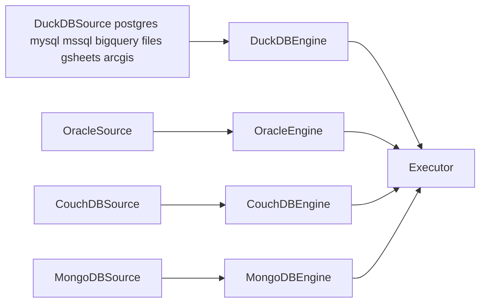

# `toolkit`

Biblioteca de uso comum, com `DuckDB` como motor: SQL tipado em qualquer fonte, `GCS`, BigQuery, `dbt` e telemetria. As regras do pacote estão em [`STYLEGUIDE.md`](STYLEGUIDE.md). O comportamento de cada função está na `docstring` dela.

## Uso

O `toolkit` é um membro do `workspace` `uv`. Cada pipeline declara a dependência no `pyproject.toml`:

```toml
dependencies = ["toolkit"]

[tool.uv.sources]
toolkit = { workspace = true }
```

```python
from pathlib import Path
from typing import TypedDict

from toolkit.executor.engines.base import Engine
from toolkit.executor.executor import Executor
from toolkit.executor.sources.backends.postgres import PostgresSource
from toolkit.executor.sources.protocols import DBConn


class Total(TypedDict):
    name: str | None  # `| None` aceita nulos
    total: int


source = PostgresSource(DBConn("db.internal", 5432, "app", "reader", "..."))

async with Executor(
    Engine.from_source(source), Path(__file__).parent / "queries"
) as executor:
    totals = await executor.query("count_events", expect=Total)  # Dataset[Total]
```

O SQL é um modelo `Jinja` em `queries/count_events.sql`, que lê o banco anexado como `src`.

`expect` aceita três formas: uma classe anotada (`TypedDict`, `dataclass`, `NamedTuple`), em que `X | None` aceita nulos; um `polars.Schema` ou um mapa de tipos do `Polars`, em que um tipo sozinho é uma coluna sem nulos e `Column(tipo, nullable=True)` aceita nulos; ou nada, e então não se confere nada. `Executor.query` e `Executor.read` conferem cada lote e levantam `SchemaError` com todos os problemas.

```python
from polars import Int64, Schema, String

async for lote in executor.read(expect=Schema({"id": Int64, "nome": String})):
    ...
```

## Módulos

| Módulo              | O que faz                                                                                                                                                                                    |
| ------------------- | -------------------------------------------------------------------------------------------------------------------------------------------------------------------------------------------- |
| `toolkit.executor`  | `Executor`, `Engine`, as fontes e os modelos SQL. `query` devolve um `Dataset` tipado.                                                                                                       |
| `toolkit.functions` | As funções do `DuckDB`, que toda conexão tem. Veja a lista abaixo.                                                                                                                           |
| `toolkit.chunks`    | Os chunks de um `dump` e o `hash` da configuração.                                                                                                                                           |
| `toolkit.delta`     | A tabela `Delta` de um `dump`: `write_chunk` (troca um chunk, soma linhas com `append` ou grava a hora com `extracted_at`), `merge_chunk` (junta linhas pela chave com o `MERGE` do `Delta`, no mesmo commit do ledger), `compact`, `maintain`, `inspect_table` e `find_layout_problems`. |
| `toolkit.gcs`       | `create_store`, `list_keys`, `list_prefixes`, `upload` e `delete_keys`, com `obstore` e chaves `HMAC`.                                                                                       |
| `toolkit.bigquery`  | `BigQuery`: `has_table`, `create_dataset`, `execute` (uma instrução, como um `MERGE`) e `sync_delta_table` (tabela `Delta` por uma conexão BigLake).                                         |
| `toolkit.oracle`    | `Oracle`, o cliente `SQL` da conexão com `connect`, `execute` e `query`. A consulta volta em `Polars`, nos tipos que o `Delta` guarda.                                                       |
| `toolkit.dbt`       | `DbtRun` (um comando `dbt`) e o clone do repositório de consultas, com `GITHUB_TOKEN` no lugar do token da URL.                                                                              |
| `toolkit.settings`  | `ToolkitSettings` (o log e a telemetria) e um grupo por parte, como `GcsSettings`. Cada parte cria o seu grupo quando precisa dele.                                                          |
| `toolkit.utils`     | As colunas e os filtros de um `dump`: `normalize_column`, `build_column_aliases`, `select_columns` e `filter_conditions`.                                                                    |
| `toolkit.telemetry` | O `logger` do pacote e `configure_telemetry()`.                                                                                                                                              |

**Funções do `DuckDB`** (em SQL, sem importar nada):

- Texto: `normalize(coluna, separador, minúsculas)` e `clean_text`.
- Datas: `parse_date`, `parse_timestamp`, `ano_particao`, `mes_particao`, `data_particao`, `now_sao_paulo` e `to_sao_paulo`.
- Documentos: `is_cpf`, `normalize_cpf`, `is_cnpj` (aceita as letras do CNPJ novo), `normalize_cnpj` e `is_phone` (telefone fixo ou celular do Brasil, com ou sem `55`).
- Nomes de colunas: `Executor.normalize_columns(tabela, colunas, separador, minúsculas)`.

**Fontes** (`toolkit.executor.sources.backends`): `PostgresSource`, `MySQLSource`, `MSSQLSource`, `OracleSource`, `CouchDBSource`, `MongoDBSource`, `BigQuerySource`, `FilesSource`, `GSheetsSource` e `ArcGISSource`. `load_sources()["postgres"]` acha a classe pelo nome.

Uma **fonte** é só configuração: a conexão, as opções e a origem do que ler. Um **motor** (`Engine`) nasce de uma fonte e faz tudo com o sistema: abre a conexão, lê, executa e grava. O `Executor` recebe o motor e orquestra: abre o motor, roda os modelos `SQL` e lê os chunks de um `dump`.



Uma fonte é uma `dataclass` do `Pydantic`, e as chaves de `options` são os campos dela: `get_source("couchdb")(conn=conn, origin=origin, **options)`. Uma chave que a fonte não declara é um erro, e um campo errado também.

| Campo (de toda fonte) | O que é                                                                                                                           |
| --------------------- | --------------------------------------------------------------------------------------------------------------------------------- |
| `name`                | O nome do registro: `PostgresSource` é `postgres`. Só uma fonte que define `name` entra em `load_sources()`.                      |
| `origin`              | O que ler (`Table`, `Query`, `Changes`, `Files`, `Layer` ou `Sheet`), ou `None` para uma fonte só conectada.                      |

`Engine.from_source(fonte)` devolve o motor da fonte, ainda fechado. `async with` abre a conexão. O motor escolhe a fonte pelo atributo `source_type`, e `TypeError` diz que nenhum motor serve a fonte. `DuckDBEngine` serve toda `DuckDBSource`: carrega as extensões, roda o `setup` da fonte (o `ATTACH`) e lê no lugar. Os outros três implementam o `Engine` direto: cada um extrai (`extract`) as linhas do chunk para um `Parquet` com o cliente próprio, e abre um `DuckDBEngine` que descreve a origem e grava o arquivo final, com `describe_extracted` e `materialize_extracted` (`engines/duckdb.py`).

`Engine` é uma classe abstrata (`toolkit.executor.engines.base`). Um motor trata as origens que o sistema dele responde, com um `match` no tipo, e levanta `UnsupportedRequestError` para as outras.

| Membro                                | O que faz                                                                                                                         |
| ------------------------------------- | --------------------------------------------------------------------------------------------------------------------------------- |
| `execute(sql)`                        | Roda uma instrução `SQL` que não devolve linhas.                                                                                  |
| `query(sql, batch_size)`              | Roda uma consulta `SQL`, em `DataFrame`s do `Polars` de até `batch_size` linhas.                                                          |
| `read(batch_size)`                    | Lê a origem da fonte inteira, em `DataFrame`s do `Polars`.                                                                                |
| `describe()`                          | Devolve o nome e o tipo `DuckDB` de cada coluna da origem.                                                                        |
| `materialize(destino, linhas, colunas)` | Grava um chunk da origem como `Parquet`. Sem `colunas`, grava todas.                                                          |
| `check_chunks(chunks, colunas)`       | Levanta `ValueError` se a coluna de `chunks` não serve aos chunks. O padrão pede inteiro ou data. O CouchDB pede só o `id`.      |
| `concurrency`                         | Quantos chunks um `dump` lê ao mesmo tempo. O padrão é 1. O CouchDB e o MongoDB usam o `concurrency` da fonte (padrão 2).        |

`Executor.run_chunks(todo, plan, handle)` grava cada chunk em uma pasta temporária e o entrega ao `handle`. Cada leitor extra usa um motor próprio (`clone()`), e o `handle` roda para um chunk por vez, então ele pode gravar num lugar compartilhado. O primeiro erro cancela os outros leitores e sobe como veio.

## Bancos: tipos e limites

Conferido em Postgres, MySQL, SQL Server e Oracle de verdade.

**Tipos**

- O `Delta` não guarda `TIME`, `UUID` nem `INTERVAL`: eles chegam como texto. Um inteiro sem sinal chega no inteiro com sinal maior (`UINTEGER` em `BIGINT`), e `UBIGINT` em `DECIMAL(20, 0)`.
- Um `timestamp` com fuso (`timestamptz`, `datetimeoffset`) é cortado em dias de São Paulo, em qualquer máquina. Um `timestamp` sem fuso vale como vem do banco. O `TIMESTAMP` do MySQL vem em UTC.
- `normalize_values` limpa o texto de todo banco, inclusive o `nvarchar` do SQL Server.

**SQL Server**

- O `DuckDB` corta toda consulta em 30 s. O toolkit troca esse limite por `DB_QUERY_TIMEOUT_SECONDS` (3600).
- Numa consulta nativa, uma coluna `varchar` com acento falha com `Invalid unicode`. Use `CAST(coluna AS NVARCHAR(n))` ou leia pela tabela (`read.table`).

**Oracle**

- O `oracledb` lê com o `Instant Client` (modo `thick`, que a imagem base já tem). Sem ele, o `oracledb` usa o modo `thin`, que não lê usuários com verifier `10G`. A pasta do cliente vem de `ORACLE_CLIENT_LIB_DIR` ou do `ldconfig`.
- Cada chunk vira um `Parquet` local, com filtros e chunk aplicados pelo Oracle. `read.table` é `DONO.TABELA`, `read.query` é uma consulta (pode ter `;` no fim), e as duas aceitam `chunks` e `filters`. Cada filtro é um predicado em SQL do Oracle, ligado aos outros por `AND`, e só os valores do chunk vão como `bind`. `batch_size` (padrão 50 000) é o número de linhas de cada leitura, e vem de `options`. Os nomes das colunas são os do Oracle, em maiúsculas: `chunks: { column: DATA_PEDIDO }`.
- A tabela é lida `AS OF SCN`, com o mesmo `SCN` em todos os chunks, e uma mudança feita durante a carga não entra. Isso pede `EXECUTE` em `SYS.DBMS_FLASHBACK` ou `SELECT` em `SYS.V_$DATABASE`, e `FLASHBACK` na tabela de outro dono. Sem esses privilégios a carga segue sem o `SCN` e avisa no log. Uma consulta nunca é lida `AS OF SCN`.
- Um `NUMBER` nunca perde dígitos: até 18 dígitos sem escala é `int64`, com precisão e escala que cabem é `decimal128`, `FLOAT` é `double`, e um `NUMBER` sem precisão chega como texto exato.
- `DATE` e `TIMESTAMP` chegam sem fuso. `TIMESTAMP WITH TIME ZONE` e `WITH LOCAL TIME ZONE` chegam como o instante em UTC. `CLOB`, `NCLOB`, `NVARCHAR2`, `XMLTYPE`, `INTERVAL` e `ROWID` chegam como texto, e `RAW` e `BLOB` como bytes.
- Um tipo sem conversão (objeto, `BFILE`, `BOOLEAN`, `JSON`) falha e diz a coluna: converta na consulta.

**Postgres e MySQL:** se o servidor parar no meio de uma leitura, a execução espera para sempre. Ponha `timeout_seconds` na tarefa.

**ArcGIS:** `crs`, como `EPSG:31983`, faz o servidor responder nesse sistema de coordenadas. A geometria vira uma coluna `geoarrow.wkb` com o sistema gravado.

**Google Sheets:** o `DuckDB` lê todo número da planilha como `DOUBLE`. A planilha precisa estar compartilhada com a service account.

**CouchDB**

- O `CouchDBEngine` lê uma base pela API HTTP e grava `Parquet`, como o Oracle. A base é `read.table` (ou `conn.database`, sem ele). Há três leituras: `_all_docs` (padrão), `_find` (`query`, um seletor Mango em JSON) e `_changes` (`since`: `0`, `now` ou o `last_seq` anterior). `read` aceita `table` com `query` ou com `since`, mas não `query` com `since`.
- As colunas vêm de um `Shape` (`columns` e `row(item)`). O padrão grava `id` e `doc`, que o `DuckDB` lê como `JSON`: `doc->>'$.campo'`. O `BigQuery` lê `doc` como `STRING`: use `PARSE_JSON`.
- Um chunk corta os ids numéricos com `startkey` e `endkey`. Com `key_width=N`, o corte usa os N primeiros dígitos e serve a ids de larguras mistas. O chunk `null` lê o resto, como os ids com letra. Os `_design/` nunca entram.
- Cada filtro é um seletor Mango em JSON, e os filtros se ligam por `$and`. Com filtros, a leitura usa `_find`, e o chunk vira uma faixa de `_id`. Por isso `chunks.column` precisa ser `id`, e os filtros não vão com `query` nem com `since`. `query` e `since` não vão juntos, e cada um é um chunk só.
- `page_size`, `verify_tls`, `secure`, `path_prefix` e `timeout` vêm do construtor ou das variáveis `COUCHDB_*` da tabela abaixo. `key_width` só vem do construtor ou de `options`. Pelo `get_source`, a fonte recebe `options` do `database` do `prefect.yaml`: `shape` (um caminho `módulo:nome`, como `utils.couchdb:BCADASTRO`), `key_width` e `batch_size` (documentos por página, no lugar de `COUCHDB_PAGE_SIZE`). Qualquer outra chave é um erro. `_all_docs` rendeu cerca de 30 000 documentos por segundo, e `_changes` 13 000: use `_changes` só para cargas incrementais.

**MongoDB**

- O `MongoDBEngine` lê uma coleção com o `PyMongoArrow` (`find_arrow_all`), em páginas de `batch_size` documentos por `_id`, e grava `Parquet`. A coleção é `read.table`, e `read.query` é um filtro `JSON` da coleção.
- `options.shape` é obrigatório: o caminho `módulo:nome` de um `Schema` do `PyMongoArrow`. Numa leitura por páginas ele precisa do campo `_id`, e numa agregação ele descreve o resultado. Sem esquema, as colunas mudariam de um chunk para outro. Um `ObjectId` chega como o texto hexadecimal e um `Decimal128` como texto exato.
- Cada filtro é um documento de consulta em `JSON`, e os filtros se ligam por `$and`. Um chunk é uma faixa `$gte` e `$lt` de um campo de data ou de número, e o chunk `null` é `{campo: null}`.
- `Aggregate` é uma lista de estágios de agregação, em texto `JSON`, sobre a coleção de `read.table`. No `prefect.yaml`, `read.pipeline` é o nome de um arquivo `JSON` da pasta `pipelines/` da pipeline (`<nome>.json`, em palavras minúsculas com hífen), e `utils` a lê. O `MongoDBEngine` roda `aggregate_arrow_all` com um `$match` na frente (os filtros e o chunk, nos campos dos documentos guardados) e depois os estágios. O resultado vem inteiro, sem páginas, porque os estágios podem mudar o `_id`: o `batch_size` não vale e o `shape` descreve o resultado, sem `_id`. `pipeline` não vai com `query` nem com `since`, e o `hash` da configuração conta os estágios.
- O `dump` normaliza os nomes das colunas, então o `_id` vira `id`, e um campo `id` do documento vira `id_1`. Se o `_id` não faz falta, deixe-o de fora com `select`, e o campo `id` fica com o nome `id`.
- `auth_source` e `tls` vão na cadeia de conexão. A senha vai com os caracteres especiais escapados.
- O MongoDB é um extra do toolkit: `uv add "toolkit[mongodb]"` no pipeline que lê MongoDB. Sem o extra, `load_sources()` não lista `mongodb` e `get_source("mongodb")` levanta `ValueError` com o comando de instalação. O extra decide só o que cada imagem instala, e não a versão do `pyarrow`.
- O `pymongoarrow` fixa o `pyarrow` numa versão menor (a 1.15 pede `>=25.0,<25.1`), e cada versão dele acompanha um `pyarrow` novo com um atraso de 1 a 7 semanas. O workspace tem um só lock, então todo membro usa o mesmo `pyarrow`, também as imagens sem o extra. O `pyarrow` 25.0.1 aumentou a struct `Array` e faz o `pymongoarrow` 1.15 avisar no import, por isso o extra `mongodb` fixa `pyarrow==25.0.0`. Dividir o lock por extra funciona no `uv`, mas pede `prefect_rj_iplanrio[latest]` em todas as pipelines e quebra `uv sync --all-packages`, e a equipe preferiu seguir o `pymongoarrow`. Quando sair o `pymongoarrow` 1.16 (a `main` já pede `pyarrow>=26.0.0,<26.1`), apague o pino e rode `uv lock --upgrade-package pymongoarrow`: o `pyarrow` passa a seguir a faixa dele.

## Configuração

A autenticação do Google é por workload identity (ADC), sem arquivo de service account. As variáveis são lidas do ambiente. `LOG_LEVEL` e `OTEL_*` valem para todas as partes, e cada parte lê as do seu grupo só quando roda:

| Variável                      | Padrão                   | Uso                                                                                                            |
| ----------------------------- | ------------------------ | -------------------------------------------------------------------------------------------------------------- |
| `GCS_HMAC_ACCESS_ID`          | vazio                    | Chave `HMAC` do `GCS` (API compatível com S3).                                                                 |
| `GCS_HMAC_SECRET`             | vazio                    | Segredo `HMAC` do `GCS`.                                                                                       |
| `GCS_ENDPOINT`                | `storage.googleapis.com` | Endpoint do `GCS`.                                                                                             |
| `GCS_REGION`                  | `auto`                   | Região enviada ao `store` S3.                                                                                  |
| `GCS_USE_SSL`                 | `true`                   | Usa HTTPS.                                                                                                     |
| `BIGQUERY_PROJECT`            | vazio                    | Projeto das tabelas externas e da fonte `bigquery`.                                                            |
| `DISCORD_WEBHOOK_URL`         | vazio                    | Webhook do Discord de `notify_discord` e do aviso de falha dos flows. Segredo. Vazio desliga o aviso.          |
| `GITHUB_TOKEN`                | vazio                    | Token de GitHub que preenche `GITHUB_TOKEN` na URL de um repositório privado do `dbt`. Segredo.                |
| `COUCHDB_PAGE_SIZE`           | `10000`                  | Documentos por página de uma leitura do CouchDB.                                                               |
| `COUCHDB_PATH_PREFIX`         | vazio                    | Prefixo do caminho de um CouchDB atrás de um proxy, como `/couchdb`.                                           |
| `COUCHDB_SECURE`              | vazio                    | `true` usa HTTPS e `false` usa HTTP. Vazio usa HTTP só na porta 5984.                                          |
| `COUCHDB_TIMEOUT_SECONDS`     | `300`                    | Segundos que uma página de uma leitura do CouchDB pode levar.                                                  |
| `COUCHDB_VERIFY_TLS`          | `true`                   | Verifica o certificado do CouchDB. `false` aceita um certificado que não casa com o endereço.                  |
| `DB_QUERY_TIMEOUT_SECONDS`    | `3600`                   | Limite de uma consulta no SQL Server (o padrão da extensão é 30 s).                                            |
| `ORACLE_CLIENT_LIB_DIR`       | vazio                    | Pasta do `Instant Client` do Oracle. Vazio usa o `ldconfig`, e sem o cliente o `oracledb` roda em modo `thin`. |
| `DUCKDB_MEMORY_LIMIT`         | vazio                    | Limite de memória do `DuckDB`, como `4GB`.                                                                     |
| `DUCKDB_TEMP_DIRECTORY`       | vazio                    | Pasta onde o `DuckDB` grava o que não cabe na memória.                                                         |
| `OTEL_EXPORTER_OTLP_ENDPOINT` | vazio                    | Coletor `OTLP/HTTP`, como `http://coletor:4318`. Vazio desliga o envio.                                        |
| `OTEL_EXPORTER_OTLP_HEADERS`  | vazio                    | Cabeçalhos do coletor, `chave=valor,chave2=valor2`. Segredo.                                                   |
| `OTEL_SERVICE_NAME`           | `prefect-rj-iplanrio`    | Nome do serviço nos logs, traces e métricas.                                                                   |
| `LOG_LEVEL`                   | `INFO`                   | Nível do log.                                                                                                  |
| `DB_USERNAME` e `DB_PASSWORD` | obrigatórias             | Usuário e senha do banco que o deployment lê. Vazio ou ausente é um erro.                                      |

## Logs, traces e métricas

```python
from toolkit.telemetry import logger

logger.info("Files uploaded: prefix=%s files=%d", "ds/tb", 3)
```

Importar `toolkit.telemetry` já liga o envio, se `OTEL_EXPORTER_OTLP_ENDPOINT` existir. Toda pipeline importa o `toolkit` ou o `utils` (`nu scripts/checks.nu lint telemetry` confere), então todas enviam. Todo log, span e contador de um flow run leva três atributos, lidos das tags do deployment: `environment`, `severity` e `code_owner`. Fora de um flow run, ou sem a tag, o atributo não existe.

O destino é o `SigNoz`, por `OTLP/HTTP`. O `toolkit` acrescenta `/v1/logs`, `/v1/traces` e `/v1/metrics` ao endpoint:

```bash
# SigNoz auto-hospedado
OTEL_EXPORTER_OTLP_ENDPOINT=http://signoz-otel-collector:4318

# SigNoz Cloud
OTEL_EXPORTER_OTLP_ENDPOINT=https://ingest.us.signoz.cloud:443
OTEL_EXPORTER_OTLP_HEADERS=signoz-ingestion-key=<chave>
```

A chave de ingestão é um segredo: injete `OTEL_EXPORTER_OTLP_HEADERS` como as outras credenciais, nunca no código nem no `prefect.yaml`.

- **Logs:** o `logger` é `prefect.toolkit`, com o formato padrão do `Prefect`. Com o endpoint, todo log da árvore `prefect` segue para o coletor, e um log numa `run` leva o `trace_id` dela.
- **Traces:** o `Prefect` cria um `span` por `flow run` e por `task run`. O `toolkit` cria um por operação, filho da `run`: `toolkit.query`, `toolkit.execute`, `toolkit.upload` e `toolkit.delete`. O `SigNoz` calcula duração e taxa de erro a partir deles.
- **Métricas:** só contadores, para os totais que um `span` não dá: `toolkit.query.rows`, `toolkit.gcs.uploaded.files`, `toolkit.gcs.uploaded.bytes` e `toolkit.gcs.deleted.files`.
- Os `flows` de `utils.flows` já chamam `configure_telemetry()` ao serem importados. `configure_telemetry()` roda depois de `import prefect`, porque o `Prefect` refaz o `logging` ao ser importado e remove os `handlers` anteriores.
- Pare um resultado antes do fim com `contextlib.aclosing`, senão o `span` só termina quando o gerador é coletado.

## Desenvolvimento

Na raiz do repositório, o `devenv` roda as verificações (veja o [README da raiz](../../README.md#desenvolvimento)):

```sh
devenv --profile checks tasks run lint:all test:all
```

Ou, no diretório `packages/toolkit/`, uma ferramenta de cada vez:

```sh
uv run ruff check . && uv run ruff format --check .
uv run basedpyright
uv run sqlfluff lint toolkit/executor/templates
uv run vulture toolkit tests
uv run pytest
```

`pytest -m 'not s3 and not extensions'` roda só os testes que não precisam de serviço nem de rede. As regras dos testes estão na Seção 7 do guia, e a lista das verificações na Seção 8.
