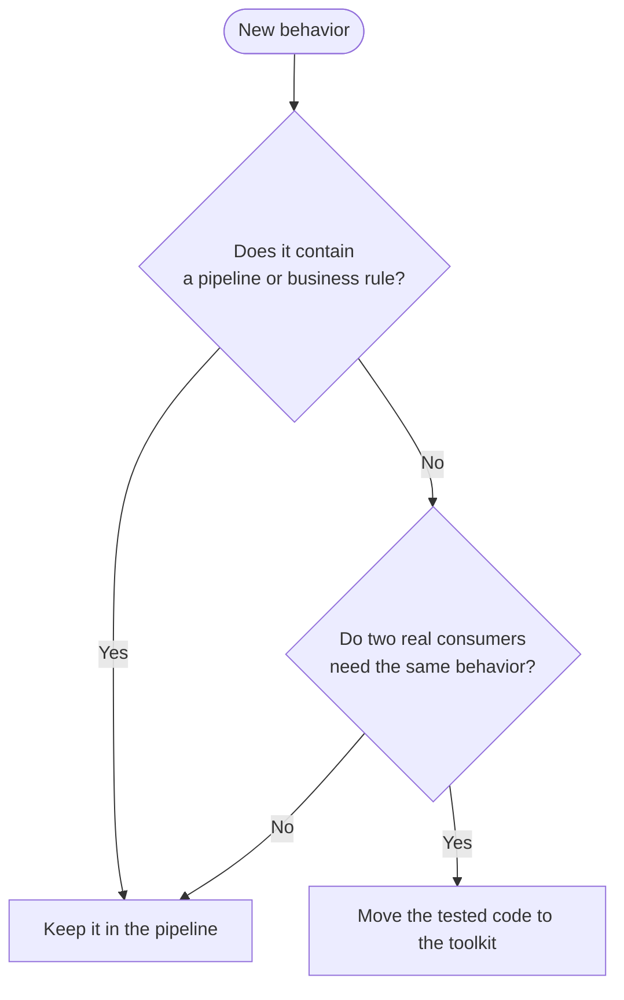

# Toolkit style guide

The root [`STYLEGUIDE.md`](../../STYLEGUIDE.md) applies here. This guide contains only rules specific to `packages/toolkit`.

The toolkit provides generic primitives. It has no pipeline name, dataset, table id, business rule, Prefect flow, or Prefect task.

Run these checks before review:

```sh
uv run --directory packages/toolkit ruff check .
uv run --directory packages/toolkit ruff format --check .
uv run --directory packages/toolkit basedpyright
uv run --directory packages/toolkit sqlfluff lint toolkit/executor/templates
uv run --directory packages/toolkit vulture toolkit tests
uv run --directory packages/toolkit pytest -q
```

`devenv --profile checks tasks run lint:all test:all` runs the same checks in the complete repository.

## 1. Scope and dependencies

### generic-second-use

- **Level:** MUST
- **Check:** review
- **Rule:** Add a primitive to the toolkit only after two real consumers need the same domain-free behavior.
- **Why:** The toolkit is a stable shared contract, not a store for possible future code.



|   | Situation | Decision |
|---|---|---|
| ✅ | Two database pipelines need the same chunk fingerprint algorithm. | Move the tested algorithm to `toolkit/chunks.py`. |
| ❌ | One CRM pipeline needs a Salesforce rule. | Keep it in the CRM pipeline, even if another pipeline might need it later. |

### no-domain-values

- **Level:** MUST NOT
- **Check:** `.ast-grep/rules/no-pipeline-names-in-toolkit.yaml` and review
- **Rule:** Do not put a pipeline name, dataset, table id, schedule, or business rule in the toolkit.
- **Why:** A generic package cannot own deployment-specific facts.

Compliant: `DEFAULT_BATCH_SIZE = 50_000`

Non-compliant: `TAXIRIO_RACES_TABLE = "races"`

### dependency-direction

- **Level:** MUST
- **Check:** basedpyright, Ruff, and review
- **Rule:** A toolkit module imports only its own layer or a lower layer. `types.py` imports no toolkit module.
- **Why:** One dependency direction prevents cycles.

Compliant:

```python
# toolkit/executor/executor.py
from toolkit.executor.engines.base import Engine
```

Non-compliant:

```python
# toolkit/types.py
from toolkit.executor import Executor
```

## 2. Layout

### module-owner

- **Level:** MUST
- **Check:** review
- **Rule:** Put each symbol in the module that owns its domain.
- **Why:** A reader should find a GCS operation in `gcs.py` and a Delta operation in `delta.py`.

| Module         | Owns                                                    |
| -------------- | ------------------------------------------------------- |
| `executor/`    | Engines, sources, requests, datasets, and SQL execution |
| `settings.py`  | Toolkit settings groups                                 |
| `functions/`   | Functions registered in DuckDB                          |
| `utils.py`     | Column and filter construction                          |
| `telemetry.py` | Logger and OpenTelemetry setup                          |
| `constants.py` | Constants used by two or more toolkit modules           |
| `types.py`     | Shared type aliases                                     |
| `chunks.py`    | Chunk boundaries, keys, and fingerprints                |
| `delta.py`     | Delta ledger, chunk writes, compaction, and inspection  |
| `gcs.py`       | GCS access through obstore                              |
| `bigquery.py`  | BigQuery instructions and external tables               |
| `oracle.py`    | The Oracle SQL client                                   |
| `dbt.py`       | dbt request and repository operations                   |

Compliant: `list_keys` in `toolkit/gcs.py`.

Non-compliant: `list_gcs_keys` in `toolkit/utils.py`.

### empty-init

- **Level:** MUST
- **Check:** review
- **Rule:** Keep each toolkit `__init__.py` empty.
- **Why:** Every import path is explicit and no symbol has a hidden second path.

Compliant: `from toolkit.gcs import list_keys`

Non-compliant: `from toolkit import list_keys`

### shared-constant-and-type

- **Level:** MUST
- **Check:** `.ast-grep/rules/types-imports-no-toolkit.yaml` and review
- **Rule:** Put cross-module constants in `constants.py` and cross-module type aliases in `types.py`.
- **Why:** Each shared fact has one owner.

Compliant:

```python
# constants.py
BATCH_COLUMN = "batch"
```

Non-compliant: define `BATCH_COLUMN` in both `chunks.py` and `delta.py`.

A class with behavior stays in its domain module. A data-only class shared by modules belongs in `types.py`.

## 3. Public API

### stable-import-path

- **Level:** MUST
- **Check:** tests and review
- **Rule:** Treat each public import path as a contract. Update every consumer in the same change when a path or return value changes.
- **Why:** The repository does not provide compatibility re-exports.

Compliant: rename a symbol and update all imports in one pull request.

Non-compliant: re-export the old symbol from `__init__.py`.

### explicit-parameters

- **Level:** SHOULD
- **Check:** Ruff, basedpyright, and review
- **Rule:** Use named functions and explicit parameters instead of opaque lambdas, `Any`, `object`, and `**kwargs`.
- **Why:** The type checker can verify an explicit contract.

Compliant:

```python
def read_chunk(source: Source, chunk: Chunk) -> Dataset[Row]: ...
```

Non-compliant:

```python
def read_chunk(**kwargs: Any) -> object: ...
```

### no-unused-parameter

- **Level:** MUST
- **Check:** Ruff `ARG`
- **Rule:** Do not accept a parameter that the function does not use.
- **Why:** An unused parameter gives a false contract.

Compliant: remove the parameter.

Non-compliant: rename it to `_unused`.

## 4. SQL and DuckDB

### sql-template-only

- **Level:** MUST
- **Check:** SQLFluff and review
- **Rule:** Put every SQL operation in a Jinja template under `toolkit/executor/templates/`.
- **Why:** Templates are lintable, typed at their inputs, and reusable by engines.

Compliant:

```sql
{#
{"kind":"template","description":"Read one chunk.","inputs":{"table":"Source table."}}
#}
SELECT * FROM {{ table }}
```

Non-compliant:

```python
connection.execute(f"SELECT * FROM {table}")
```

### sql-template-header

- **Level:** MUST
- **Check:** SQLFluff and tests
- **Rule:** Start each template with a JSON header that defines `kind`, `description`, and `inputs`.
- **Why:** The header documents the executable contract for tools and people.

A macro also defines `name` and `returns`.

Compliant:

```sql
{# {"kind":"macro","name":"clean","description":"Clean text.","inputs":{"value":"Text."},"returns":"Clean text."} #}
```

Non-compliant: a template with no header.

### executor-owns-duckdb

- **Level:** MUST
- **Check:** Ruff `TID251` and review
- **Rule:** Open DuckDB only through `DuckDBEngine` and run SQL through `Executor`.
- **Why:** The engine installs extensions, functions, limits, and telemetry once.

Compliant:

```python
async with DuckDBEngine() as engine:
    executor = Executor(engine, templates)
    await executor.query("items", {}, expect=Item)
```

Non-compliant:

```python
import duckdb

connection = duckdb.connect()
```

### executor-result-contract

- **Level:** MUST
- **Check:** basedpyright and tests
- **Rule:** Give `Executor.query` and `Executor.read` an `expect` schema or annotated row type.
- **Why:** The boundary rejects wrong names, nulls, and types near the source.

Compliant: `await executor.query("items", {}, expect=Item)`

Non-compliant: read rows and cast each field later.

## 5. Engines and sources

### source-is-configuration

- **Level:** MUST
- **Check:** tests and review
- **Rule:** A Source stores configuration only. It does not connect, query, or perform I/O.
- **Why:** Source construction must have no side effect.

Compliant:

```python
@dataclass(frozen=True, slots=True, config=SOURCE_CONFIG)
class ExampleSource(Registered):
    name = "example"
    host: str
```

Non-compliant: call a network client in `__post_init__`.

### engine-owns-system-io

- **Level:** MUST
- **Check:** tests and review
- **Rule:** An Engine opens the system, reads it, and materializes chunks inside `async with`.
- **Why:** One object owns connection lifetime and cleanup.

Compliant: `MongoDBEngine.materialize()` writes the requested chunk to local Parquet.

Non-compliant: `MongoDBSource` opens `MongoClient`.

### one-engine-per-source-family

- **Level:** MUST
- **Check:** tests and review
- **Rule:** Implement a new system as one Source in `sources/backends/` and one direct Engine subclass when DuckDB cannot read it.
- **Why:** `Engine.from_source` discovers engines without a central factory branch.

Compliant: `CouchDBSource` plus `CouchDBEngine`.

Non-compliant: add an `if source.type == "couchdb"` branch to `Executor`.

### local-parquet-boundary

- **Level:** MUST
- **Check:** tests and review
- **Rule:** An engine that DuckDB cannot read writes each extracted chunk to local Parquet, then delegates the remaining work to `DuckDBEngine`.
- **Why:** Every source then shares the same normalization and fingerprint behavior.

Compliant: MySQL materializes to Parquet before Delta writing.

Non-compliant: MySQL writes rows directly to Delta with a second schema implementation.

### validate-response-at-source

- **Level:** MUST
- **Check:** tests and basedpyright
- **Rule:** Validate HTTP response bodies with models in `executor/sources/models.py`.
- **Why:** The rest of the engine uses typed fields without repeated casts.

Compliant: parse an API page into `PageResponse` once.

Non-compliant: use `dict[str, Any]` through the engine.

## 6. Storage and cloud

### obstore-only-in-gcs

- **Level:** MUST
- **Check:** Ruff `TID251` and `.ast-grep/rules/no-obstore-outside-gcs.yaml`
- **Rule:** Import `obstore` only in `toolkit/gcs.py`.
- **Why:** One module owns GCS credentials, retries, and object operations.

Compliant:

```python
from toolkit.gcs import list_keys
```

Non-compliant:

```python
import obstore
```

### deltalake-only-in-delta

- **Level:** MUST
- **Check:** Ruff `TID251` and `.ast-grep/rules/no-deltalake-outside-delta.yaml`
- **Rule:** Import `deltalake` only in `toolkit/delta.py`.
- **Why:** One module owns Delta commits and ledger rules.

Compliant: `from toolkit.delta import inspect_table`

Non-compliant: `from deltalake import DeltaTable` outside `toolkit/delta.py`.

### bigquery-only-in-bigquery

- **Level:** MUST
- **Check:** `.ast-grep/rules/no-bigquery-client-in-toolkit.yaml` and review
- **Rule:** Put direct BigQuery client operations in `toolkit/bigquery.py`.
- **Why:** One client owns ADC, instructions, table creation, and errors.

Compliant: call a method of `toolkit.bigquery.BigQuery`.

Non-compliant: create `google.cloud.bigquery.Client()` in `toolkit/delta.py`.

### adc-only

- **Level:** MUST
- **Check:** `.ast-grep/rules/no-service-account-file.yaml` and review
- **Rule:** Use Application Default Credentials and never load a service-account file in toolkit code.
- **Why:** Workload identity rotates credentials and avoids committed keys.

Compliant: `google.auth.default(scopes=SCOPES)`

Non-compliant: `service_account.Credentials.from_service_account_file(path)`

### delta-table-output

- **Level:** MUST
- **Check:** tests and review
- **Rule:** Write every toolkit-managed table in GCS as Delta and publish it as a BigLake external table.
- **Why:** Atomic commits and the ledger prevent partial and repeated data.

Compliant: materialize Parquet locally, write a Delta chunk, then publish.

Non-compliant: publish a folder of loose CSV files.

## 7. Settings

### settings-by-domain

- **Level:** MUST
- **Check:** basedpyright and review
- **Rule:** Give each toolkit domain its own `ToolkitSettings` subclass and instantiate it only when needed.
- **Why:** Importing a module must not read the environment.

Compliant:

```python
def connect() -> Client:
    settings = GcsSettings()
    return Client(settings.GCS_ACCESS_KEY)
```

Non-compliant:

```python
SETTINGS = GcsSettings()
```

The base settings class contains only values every toolkit domain uses, such as `LOG_LEVEL` and `OTEL_*`.

## 8. Telemetry

### toolkit-logger

- **Level:** MUST
- **Check:** `.ast-grep/rules/no-stdlib-logger.yaml` and review
- **Rule:** Log through `toolkit.telemetry.logger` with lifecycle messages and bounded context.
- **Why:** One logger sends INFO messages and telemetry with the same labels.

Compliant: `logger.info("Chunk written: rows=%d", rows)`

Non-compliant: `logging.getLogger(__name__).info("done")`

### spans-for-operations

- **Level:** SHOULD
- **Check:** review
- **Rule:** Wrap a query, write, send, or delete operation in one named span.
- **Why:** The span already provides duration and error state.

Compliant: one `gcs.object.write` span around an object write.

Non-compliant: a custom duration histogram for the same operation.

Use metrics only for totals that a span cannot give, such as rows or bytes. Keep attributes low-cardinality.

## 9. Tests

### test-owned-behavior

- **Level:** MUST
- **Check:** pytest and review
- **Rule:** Test toolkit behavior, not the implementation of DuckDB, Polars, Prefect, OpenTelemetry, or a cloud SDK.
- **Why:** A test must fail only when our contract breaks.

Compliant: verify that a changed chunk replaces only its prior batch.

Non-compliant: verify that `pl.DataFrame` stores the value passed to it.

### parity-for-engine

- **Level:** MUST
- **Check:** parity tests and review
- **Rule:** Add each new engine to `tests/parity/` and compare its rows and types with the other engines.
- **Why:** Every engine must expose the same dataset contract.

Compliant: add the source service to `tests/parity/engines.nu` and the expected dataset case.

Non-compliant: add an engine with only mocked unit tests.

### deterministic-tests

- **Level:** MUST
- **Check:** pytest and review
- **Rule:** Keep tests independent, deterministic, and offline unless they use an explicit service marker.
- **Why:** CI must reproduce every failure.

Compliant: use `tmp_path`, in-memory DuckDB, and a fake external client.

Non-compliant: read a production bucket in a unit test.

### regression-test

- **Level:** MUST
- **Check:** review
- **Rule:** Add a focused test for every bug and confirm it fails before the fix.
- **Why:** The test prevents the same bug from returning.

Compliant: a test named for the scenario with `Regression` in its docstring.

Non-compliant: weaken an existing assertion until the fix passes.
