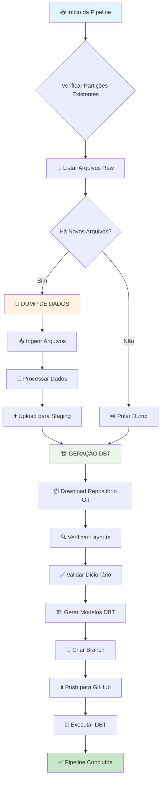

# rj_smas__cadunico

Carrega os arquivos do CadÚnico, gera os modelos `dbt` de cada tipo de registro e os materializa no BigQuery.


## 🧭 Como funciona (resumo)

> **TL;DR**
>
> **O dado**
>
> - Cada extração do CadÚnico chega no bucket raw como um ZIP com **um único TXT de largura fixa**: sem delimitador e com vários GB.
> - Nesse TXT estão **as 23 tabelas misturadas** (domicílio, família, pessoa, escolaridade, renda…), uma linha por registro.
>
> **O layout**
>
> - Para saber onde cada coluna começa e termina é preciso o **layout oficial em XLSX**, um arquivo por versão.
> - O layout **muda entre versões**: colunas entram, saem e mudam de posição ou tamanho. No histórico convivem extrações de versões diferentes.
> - Nome padronizado, tipo e decodificação de categorias não estão no layout. Eles vêm de uma **planilha de dicionário** mantida à mão.
>
> **A solução**
>
> 1. **Ingestão crua**: o TXT sobe para o BigQuery como uma tabela de **uma coluna só (`text`)**, particionada por versão do layout e por data. Nada é interpretado nessa etapa, então mudança de layout não quebra a ingestão.
> 2. **Layouts para tabela**: os XLSX são lidos e viram uma tabela de layout no BigQuery, cruzada com a planilha de dicionário.
> 3. **Modelos gerados**: a partir dos layouts, a pipeline **gera automaticamente um modelo dbt por tabela**. Cada modelo filtra as linhas pelo código do registro, recorta as colunas com `SUBSTRING(posição, tamanho)` e une todas as versões. Uma coluna que não existe numa versão vira `NULL`.
> 4. **Publicação**: os modelos são commitados na branch `cadunico` do `queries-rj-iplanrio` e materializados com `dbt run`.
>
> Quando sai um layout novo, basta subir o XLSX e cadastrar as colunas novas no dicionário. Não é preciso escrever código.

### O dado de origem

- Os dados chegam em `rj-smas/raw/protecao_social_cadunico/registro_familia`, um ZIP por extração. A data vem no nome do arquivo, em um destes formatos: `A<YYMMDD>`, `YYYYMMDD` ou `YYYYMM`.
- Dentro do ZIP há um TXT de **largura fixa**, sem delimitador, com vários GB.
- Um único arquivo mistura **todos os tipos de registro** (domicílio, família, pessoa, escolaridade, renda…). O tipo de cada linha fica nas posições 38–39 (`SUBSTRING(text,38,2)`). São 23 registros: `00`–`21`, `98` e `99` (ver `get_tables_names_dict`).
- A primeira linha (header) traz a **versão do layout** (posições 70–74) e a data da extração (posições 83–90).
- O que cada posição significa é definido pelo **layout oficial em XLSX** (`BMM_V*.xlsx`, em `rj-smas/raw/protecao_social_cadunico/layout`). Esse layout muda entre versões: colunas entram, saem e mudam de posição ou tamanho.

### Por que é complexo subir esses dados

1. **Volume**: TXTs de vários GB, quebrados em pedaços de ~1GB antes do upload.
2. **Sem schema fixo**: a mesma posição pode significar coisas diferentes em versões diferentes do layout.
3. **Várias tabelas num arquivo só**: os 23 tipos de registro vêm intercalados no mesmo TXT.
4. **Várias versões no histórico**: partições antigas e novas seguem layouts diferentes e precisam ser consultadas juntas.
5. **Layout pensado para humanos**: o XLSX tem tabelas espalhadas pelas abas, células mescladas e nomes de coluna repetidos. Isso exige um parser próprio (`parse_tables_from_xlsx`).
6. **Padronização fora do layout**: nome padronizado, tipo BigQuery, formato de data, ajuste decimal e decodificação de categorias não estão no XLSX. Eles vêm de uma planilha mantida manualmente, a tabela `layout_dicionario_colunas`.

### Estratégia: ELT em duas camadas

**1. Staging com texto cru (ingestão nunca quebra por layout)**

Cada linha do TXT vira uma linha em `brutos_cadunico_staging.registro_familia`, com uma única coluna `text`. O truque é renomear o `.txt` para `.csv` e declarar o delimitador `Æ`, que não aparece no arquivo. Assim o BigQuery lê a linha inteira como uma coluna só. A tabela é particionada por `versao_layout_particao / ano_particao / mes_particao / data_particao`.

Na ingestão não há nenhuma interpretação do conteúdo. Por isso uma mudança ou correção de layout não exige reprocessar o dado bruto, só regenerar os modelos.

**2. Parsing no BigQuery via dbt**

Cada tipo de registro vira um modelo `raw_protecao_social_cadunico__<tabela>`. Para cada coluna, o modelo aplica `SUBSTRING(text, posicao, tamanho)` com o cast adequado (DATE, INT64, FLOAT64 com ajuste decimal) e decodifica categorias (`dicionario_atributos`). As versões são unidas com `UNION ALL`:

```sql
SELECT <colunas segundo layout 0703> FROM staging
WHERE versao_layout_particao = '0703' AND SUBSTRING(text,38,2) = '03'
UNION ALL
SELECT <colunas segundo layout 0704> FROM staging
WHERE versao_layout_particao = '0704' AND SUBSTRING(text,38,2) = '03'
```

### Por que os modelos são gerados dinamicamente

- **Escala**: são 23 tabelas × N versões × dezenas de colunas, ou seja, milhares de expressões `SUBSTRING`. Escritas à mão, um offset errado gera dado errado sem nenhum erro aparente.
- **Fonte da verdade única**: as posições saem direto do layout oficial, sem digitação manual.
- **Compatibilidade entre versões**: a tabela `layout_columns_version_control` registra quais colunas não existem em cada versão. Essas colunas viram `NULL AS <coluna>`, e assim todas as partes do `UNION ALL` ficam com o mesmo schema.
- **Nova versão sem código**: basta subir o XLSX novo no raw e cadastrar as colunas novas na planilha de dicionário. A pipeline regenera os modelos e materializa.
- **Validação antes de gerar**: se faltar no dicionário alguma coluna do layout, ou se houver dado em staging de uma versão sem layout, a pipeline para e lista o que falta.

### Por que os modelos vão para o repositório de queries

O dbt precisa dos `.sql`/`.yml` dentro do projeto para materializar e documentar as tabelas. Os arquivos gerados vão por commit na branch `cadunico` do `queries-rj-iplanrio`, em `models/raw/smas/protecao_social_cadunico/`. O diff de cada commit mostra o que mudou entre layouts.

### Passo a passo de uma execução

1. Lista as partições `data_particao` que já estão em staging e compara com os ZIPs do raw.
2. Ingere os ZIPs novos (até `max_concurrent` em paralelo): baixa → extrai → divide → sobe para staging.
3. Se algo foi ingerido, ou se `force_create_models=True`:
   1. Clona o `queries-rj-iplanrio` na branch `cadunico`.
   2. Sincroniza layouts novos (XLSX → `brutos_cadunico_staging.layout`).
   3. Valida as colunas contra `layout_dicionario_colunas`.
   4. Gera `layout_columns_version_control` e os modelos dbt.
   5. Faz commit e push na branch `cadunico`.
   6. Roda `dbt run` nos modelos `raw.smas.protecao_social_cadunico`.

## 🔄 Fluxo da Pipeline



## Fluxo

1. Cada ZIP de `raw.records_prefix` cuja data não está na tabela `tables.records` vira um dia dela. A data vem do nome do arquivo e a carga é um `append` com essa data como captura, então uma nova execução não duplica nada.
2. Com ZIP novo, ou com `force_create_models`, as planilhas de layout de `raw.layout_prefix` carregam na tabela `tables.layout` se o bucket tem uma versão que a tabela não tem. A tabela é sempre reescrita por inteiro.
3. Com layout novo, ou com `force_create_models`, o flow lê o layout junto do dicionário de colunas (`layout_dicionario_colunas`), grava o controle de colunas entre versões em `<layout>_columns_version_control`, escreve um modelo `dbt` por tipo de registro e faz `push` na branch de `dbt`.
4. O flow roda o comando `dbt` de `dbt` nessa branch. Sem ZIP novo e sem `force_create_models`, a execução termina no passo 1.

## Parâmetros

| Parâmetro             | Descrição                                                                                       |
| --------------------- | ----------------------------------------------------------------------------------------------- |
| `cloud`               | Bucket, projeto e conexão BigLake das tabelas.                                                  |
| `dbt`                 | `DbtRun`: repositório das consultas (com `GITHUB_TOKEN` na URL), branch, `target` e `select`.   |
| `raw`                 | Bucket e prefixos dos arquivos brutos: `records_prefix` e `layout_prefix`.                      |
| `tables`              | `dataset_id`, `records` e `layout`.                                                             |
| `force_create_models` | Gera os modelos e roda o `dbt` mesmo sem ZIP novo.                                              |

## Pré-requisitos

- Toda coluna do layout precisa de uma linha na planilha `dicionario_colunas_cadunico`. Sem ela, o flow falha e lista as colunas.
- Toda versão de layout que está nos registros precisa de uma planilha no bucket de layout.
- `GITHUB_TOKEN` com permissão de escrita no repositório das consultas.

## Código

- `helpers/layout.py`: lê as planilhas e nomeia as colunas.
- `helpers/versions.py`: acompanha as colunas de uma versão para a seguinte.
- `helpers/models.py` e `queries/model.sql`: descrevem e escrevem os modelos `dbt`.
- `helpers/repository.py`: faz o `commit` e o `push` dos modelos.
- `helpers/prepare.py`, `helpers/files.py` e `helpers/storage.py`: baixam os arquivos brutos e os transformam em Parquet.
