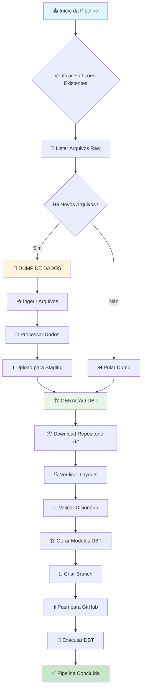

# Pipeline CadÚnico - Sistema de Proteção Social

Pipeline automatizada para ingestão de dados do CadÚnico (Cadastro Único para Programas Sociais) e geração de modelos DBT para materialização no BigQuery.

## 📋 Visão Geral

Esta pipeline processa dados do CadÚnico em duas etapas principais:
1. **Dump de Dados**: Ingestão otimizada de arquivos raw para staging
2. **Geração DBT**: Criação automática de modelos DBT e materialização

O sistema utiliza layouts versionados para garantir compatibilidade entre diferentes versões dos dados, validação automática de dicionários e integração Git para versionamento de código.

## 🧭 Como funciona (resumo)

> **TL;DR**
>
> **O dado**
>
> - Cada extração do CadÚnico chega no bucket raw como um ZIP com **um único TXT de largura fixa**: sem delimitador e com vários GB.
> - Nesse TXT estão **as 23 tabelas misturadas** (domicílio, família, pessoa, escolaridade, renda…), uma linha por registro.
>
> **O layout**
>
> - Para saber onde cada coluna começa e termina é preciso o **layout oficial em XLSX**, um arquivo por versão.
> - O layout **muda entre versões**: colunas entram, saem e mudam de posição ou tamanho. No histórico convivem extrações de versões diferentes.
> - Nome padronizado, tipo e decodificação de categorias não estão no layout. Eles vêm de uma **planilha de dicionário** mantida à mão.
>
> **A solução**
>
> 1. **Ingestão crua**: o TXT sobe para o BigQuery como uma tabela de **uma coluna só (`text`)**, particionada por versão do layout e por data. Nada é interpretado nessa etapa, então mudança de layout não quebra a ingestão.
> 2. **Layouts para tabela**: os XLSX são lidos e viram uma tabela de layout no BigQuery, cruzada com a planilha de dicionário.
> 3. **Modelos gerados**: a partir dos layouts, a pipeline **gera automaticamente um modelo dbt por tabela**. Cada modelo filtra as linhas pelo código do registro, recorta as colunas com `SUBSTRING(posição, tamanho)` e une todas as versões. Uma coluna que não existe numa versão vira `NULL`.
> 4. **Publicação**: os modelos são commitados na branch `cadunico` do `queries-rj-iplanrio` e materializados com `dbt run`.
>
> Quando sai um layout novo, basta subir o XLSX e cadastrar as colunas novas no dicionário. Não é preciso escrever código.

### O dado de origem

- Os dados chegam em `rj-smas/raw/protecao_social_cadunico/registro_familia`, um ZIP por extração. A data vem no nome do arquivo, em um destes formatos: `A<YYMMDD>`, `YYYYMMDD` ou `YYYYMM`.
- Dentro do ZIP há um TXT de **largura fixa**, sem delimitador, com vários GB.
- Um único arquivo mistura **todos os tipos de registro** (domicílio, família, pessoa, escolaridade, renda…). O tipo de cada linha fica nas posições 38–39 (`SUBSTRING(text,38,2)`). São 23 registros: `00`–`21`, `98` e `99` (ver `get_tables_names_dict`).
- A primeira linha (header) traz a **versão do layout** (posições 70–74) e a data da extração (posições 83–90).
- O que cada posição significa é definido pelo **layout oficial em XLSX** (`BMM_V*.xlsx`, em `rj-smas/raw/protecao_social_cadunico/layout`). Esse layout muda entre versões: colunas entram, saem e mudam de posição ou tamanho.

### Por que é complexo subir esses dados

1. **Volume**: TXTs de vários GB, quebrados em pedaços de ~1GB antes do upload.
2. **Sem schema fixo**: a mesma posição pode significar coisas diferentes em versões diferentes do layout.
3. **Várias tabelas num arquivo só**: os 23 tipos de registro vêm intercalados no mesmo TXT.
4. **Várias versões no histórico**: partições antigas e novas seguem layouts diferentes e precisam ser consultadas juntas.
5. **Layout pensado para humanos**: o XLSX tem tabelas espalhadas pelas abas, células mescladas e nomes de coluna repetidos. Isso exige um parser próprio (`parse_tables_from_xlsx`).
6. **Padronização fora do layout**: nome padronizado, tipo BigQuery, formato de data, ajuste decimal e decodificação de categorias não estão no XLSX. Eles vêm de uma planilha mantida manualmente, a tabela `layout_dicionario_colunas`.

### Estratégia: ELT em duas camadas

**1. Staging com texto cru (ingestão nunca quebra por layout)**

Cada linha do TXT vira uma linha em `brutos_cadunico_staging.registro_familia`, com uma única coluna `text`. O truque é renomear o `.txt` para `.csv` e declarar o delimitador `Æ`, que não aparece no arquivo. Assim o BigQuery lê a linha inteira como uma coluna só. A tabela é particionada por `versao_layout_particao / ano_particao / mes_particao / data_particao`.

Na ingestão não há nenhuma interpretação do conteúdo. Por isso uma mudança ou correção de layout não exige reprocessar o dado bruto, só regenerar os modelos.

**2. Parsing no BigQuery via dbt**

Cada tipo de registro vira um modelo `raw_protecao_social_cadunico__<tabela>`. Para cada coluna, o modelo aplica `SUBSTRING(text, posicao, tamanho)` com o cast adequado (DATE, INT64, FLOAT64 com ajuste decimal) e decodifica categorias (`dicionario_atributos`). As versões são unidas com `UNION ALL`:

```sql
SELECT <colunas segundo layout 0703> FROM staging
WHERE versao_layout_particao = '0703' AND SUBSTRING(text,38,2) = '03'
UNION ALL
SELECT <colunas segundo layout 0704> FROM staging
WHERE versao_layout_particao = '0704' AND SUBSTRING(text,38,2) = '03'
```

### Por que os modelos são gerados dinamicamente

- **Escala**: são 23 tabelas × N versões × dezenas de colunas, ou seja, milhares de expressões `SUBSTRING`. Escritas à mão, um offset errado gera dado errado sem nenhum erro aparente.
- **Fonte da verdade única**: as posições saem direto do layout oficial, sem digitação manual.
- **Compatibilidade entre versões**: a tabela `layout_columns_version_control` registra quais colunas não existem em cada versão. Essas colunas viram `NULL AS <coluna>`, e assim todas as partes do `UNION ALL` ficam com o mesmo schema.
- **Nova versão sem código**: basta subir o XLSX novo no raw e cadastrar as colunas novas na planilha de dicionário. A pipeline regenera os modelos e materializa.
- **Validação antes de gerar**: se faltar no dicionário alguma coluna do layout, ou se houver dado em staging de uma versão sem layout, a pipeline para e lista o que falta.

### Por que os modelos vão para o repositório de queries

O dbt precisa dos `.sql`/`.yml` dentro do projeto para materializar e documentar as tabelas. Os arquivos gerados vão por commit na branch `cadunico` do `queries-rj-iplanrio`, em `models/raw/smas/protecao_social_cadunico/`. O diff de cada commit mostra o que mudou entre layouts.

### Passo a passo de uma execução

1. Lista as partições `data_particao` que já estão em staging e compara com os ZIPs do raw.
2. Ingere os ZIPs novos (até `max_concurrent` em paralelo): baixa → extrai → divide → sobe para staging.
3. Se algo foi ingerido, ou se `force_create_models=True`:
   1. Clona o `queries-rj-iplanrio` na branch `cadunico`.
   2. Sincroniza layouts novos (XLSX → `brutos_cadunico_staging.layout`).
   3. Valida as colunas contra `layout_dicionario_colunas`.
   4. Gera `layout_columns_version_control` e os modelos dbt.
   5. Faz commit e push na branch `cadunico`.
   6. Roda `dbt run` nos modelos `raw.smas.protecao_social_cadunico`.

## 🔄 Fluxo da Pipeline



---

## 🔧 Grupo 1: Dump de Dados

O processo de dump é responsável por ingerir e processar arquivos raw do CadÚnico de forma otimizada e incremental.

### 🎯 Objetivo
- Verificar partições já processadas
- Identificar novos arquivos para ingestão
- Processar e fazer upload para área de staging

### 📊 Tasks do Dump

#### `get_existing_partitions_task`
**Arquivo**: `tasks.py:26`
**Função**: Lista partições já processadas na área de staging
```python
def get_existing_partitions_task(prefix: str, bucket_name: str, dataset_id: str, table_id: str) -> List[str]
```

#### `get_files_to_ingest_task`
**Arquivo**: `tasks.py:31`
**Função**: Identifica arquivos novos comparando raw vs staging
```python
def get_files_to_ingest_task(prefix: str, partitions: List[str], bucket_name: str) -> List[str]
```

#### `need_to_ingest_task`
**Arquivo**: `tasks.py:36`
**Função**: Determina se há arquivos para processar
```python
def need_to_ingest_task(files_to_ingest: list) -> bool
```

#### `ingest_files_task`
**Arquivo**: `tasks.py:41`
**Função**: Processa arquivos de forma assíncrona com controle de concorrência
```python
def ingest_files_task(files_to_ingest: List[str], bucket_name: str, dataset_id: str, table_id: str, max_concurrent: int = 3) -> None
```

### 🔧 Utils do Dump

#### `utils_dump.py`
**Funções principais**:
- `get_existing_partitions()`: Lista partições em staging
- `get_files_to_ingest()`: Compara raw vs staging
- `ingest_files()`: Processamento assíncrono de arquivos
- `need_to_ingest()`: Validação de necessidade de ingestão

**Características**:
- ✅ Processamento incremental (só novos arquivos)
- ✅ Controle de concorrência configurável
- ✅ Upload direto para BigQuery
- ✅ Logs detalhados de progresso

---

## 🏗️ Grupo 2: Geração DBT e Materialização

O processo de geração DBT cria automaticamente modelos compatíveis com diferentes versões de layout e os materializa no BigQuery.

### 🎯 Objetivo
- Sincronizar layouts do storage com staging
- Validar dicionário de colunas
- Gerar modelos DBT automaticamente
- Fazer push para repositório Git
- Executar materialização no BigQuery

### 📊 Tasks da Geração DBT

#### `download_repository_task`
**Arquivo**: `tasks.py:58`
**Função**: Baixa repositório Git para geração de modelos
```python
def download_repository_task(git_repository_path: str, branch: str = "master") -> str
```

#### `update_layout_from_storage_and_create_versions_dbt_models_task`
**Arquivo**: `tasks.py:64`
**Função**: Núcleo da pipeline - sincroniza layouts e gera modelos
```python
def update_layout_from_storage_and_create_versions_dbt_models_task(
    dataset_id: str = "brutos_cadunico",
    layout_table_id: str = "layout",
    # ... outros parâmetros
)
```

#### `push_models_to_branch_task`
**Arquivo**: `tasks.py:87`
**Função**: Faz commit e push dos modelos gerados
```python
def push_models_to_branch_task(
    repository_path: str,
    github_token: Optional[str] = None,
    commit_message: str = "feat: update CadUnico models"
) -> bool
```

#### `execute_dbt_task`
**Arquivo**: `tasks.py:107`
**Função**: Executa DBT run para materialização
```python
def execute_dbt_task(target: str = "prod", select: str = "--select raw.smas.protecao_social_cadunico")
```

### 🔧 Utils da Geração DBT

#### `utils_layout.py` - Processamento de Layouts
**Funções principais**:

##### Validação e Sincronização
- `get_layout_table_from_staging()` (linha 289): Valida dicionário de colunas
- `download_files_from_storage_raw()` (linha 222): Baixa layouts novos
- `parse_xlsx_files_and_save_partition()` (linha 167): Processa arquivos Excel

##### Geração de Modelos
- `create_cadunico_dbt_consolidated_models()` (linha 501): Gera modelos DBT
- `parse_columns_version_control()` (linha 413): Controle de versões cross-layout
- `columns_version_control_diff()` (linha 376): Análise de diferenças entre versões

**Características do Layout**:
- ✅ **Validação automática**: Verifica se todas as colunas têm dicionário
- ✅ **Controle de versões**: Compatibilidade entre versões diferentes
- ✅ **Geração automática**: Modelos DBT com transformações complexas
- ✅ **Tratamento de tipos**: DATE, INT64, FLOAT64 com validações

#### `utils_dbt.py` - Integração Git e DBT
**Funções principais**:

##### Git Operations
- `download_repository()` (linha 27): Clone de repositório com branch específica
- `push_models_to_branch()` (linha 74): Push com autenticação via token
- `get_github_token()` (linha 11): Validação de token de ambiente

##### DBT Execution
- `execute_dbt()` (linha 190): Execução com PrefectDbtRunner
  - Instala dependências automaticamente
  - Suporta múltiplos comandos (run, test, build)
  - Tratamento gracioso de erros

**Características do DBT**:
- ✅ **Autenticação segura**: GitHub token via variável de ambiente
- ✅ **Commits descritivos**: Mensagens automáticas com contexto
- ✅ **Execução robusta**: deps + run com tratamento de erros
- ✅ **Flexibilidade**: targets e seleções configuráveis

---

## ⚙️ Configuração e Uso

### Variáveis de Ambiente Necessárias
```bash
GITHUB_TOKEN=ghp_xxxxxxxxxxxxx  # Token com permissões repo, contents:write
```

### Parâmetros do Flow
```python
@flow
def rj_smas__cadunico(
    raw_bucket: str = "rj-smas",
    raw_prefix_area: str = "raw/protecao_social_cadunico/registro_familia",
    staging_bucket: str = "rj-iplanrio",
    dataset_id: str = "brutos_cadunico",
    max_concurrent: int = 3,
    force_create_models: bool = False,
    git_repository_path: str = "https://github.com/prefeitura-rio/queries-rj-iplanrio",
    branch: str = "cadunico",
    dbt_target: str = "prod",
    dbt_select: str = "--select raw.smas.protecao_social_cadunico"
)
```

### Estrutura de Arquivos Gerados
```
dbt_repository/
└── models/raw/smas/protecao_social_cadunico/
    ├── raw_protecao_social_cadunico__controle.sql
    ├── raw_protecao_social_cadunico__controle.yml
    ├── raw_protecao_social_cadunico__familia.sql
    ├── raw_protecao_social_cadunico__familia.yml
    └── ... (outros modelos)
```

---

## 🔍 Características Técnicas

### Otimizações
- **Processamento incremental**: Só processa dados novos
- **Concorrência controlada**: Upload paralelo com limite configurável
- **Validação prévia**: Verifica dicionários antes da geração
- **Cache inteligente**: Reutiliza layouts já processados

### Tratamento de Erros
- **Validação de dicionário**: Para pipeline se colunas faltam
- **Verificação de versões**: Garante layouts necessários existem
- **Git operations**: Trata falhas de push/clone graciosamente
- **DBT execution**: Logs detalhados para debugging

### Monitoramento
- **Logs estruturados**: Informações detalhadas em cada etapa
- **Comparação de versões**: Raw vs staging em tempo real
- **Progresso de arquivos**: Contadores e percentuais
- **URLs de console**: Links diretos para GCS e BigQuery

---

## 📈 Métricas e Validação

### Durante Execução
- Número de arquivos processados
- Partições criadas vs existentes
- Modelos DBT gerados
- Status de push para Git
- Resultado da materialização DBT

### Validação de Qualidade
- ✅ Integridade de dados preservada
- ✅ Compatibilidade entre versões de layout
- ✅ Transformações aplicadas corretamente
- ✅ Metadados e descrições propagados