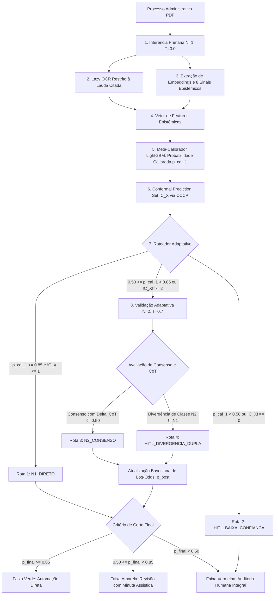

# rj_smtr__triagem_recursos

Pipeline Prefect 3.0 de triagem processual e classificação seletiva para recursos administrativos de multas de trânsito da **Secretaria Municipal de Transportes do Rio de Janeiro (SMTR-RJ)**, integrada ao monorepo da IPLANRIO.

O sistema processa petições em PDF (incluindo peças manuscritas e digitalizações com OCR ruidoso) e enquadra os processos em uma taxonomia de **7 hipóteses legais**, utilizando inferência primária determinística ($N=1$), extração local de **8 sinais epistêmicos ativos**, meta-calibração tabular via LightGBM (ajustada com validação cruzada out-of-fold e calibração isotônica) e predição conformal condicional por classe (CCCP) com roteamento bayesiano adaptativo para auditoria humana (*Human-in-the-Loop* - HITL).

---

## Arquitetura do Pipeline

O pipeline opera por meio de uma cascata adaptativa orientada a risco, desenhada para garantir acurácia $\ge 98.0\%$ no lote automatizado com multiplicador de chamadas $\le 1.10\text{x}$ por processo.

A automação direta nunca é concedida exclusivamente pelo consenso entre chamadas: a decisão final de liberação sem intervenção humana depende estritamente de a probabilidade calibrada final atingir a Faixa Verde ($p_{\text{cal}} \ge 0.85$).



---

## As 8 Features Epistêmicas Ativas

A partir de estudo de ablação empírico sobre o Golden Set de 730 processos, o vetor de features foi reduzido para **8 variáveis essenciais**, eliminando métricas redundantes e mantendo alta capacidade discriminativa (Brier Score = 0.0094):

1. `fuzz_ratio`: Similaridade de Levenshtein entre a frase citada e o texto OCR da lauda.
2. `token_containment`: Proporção de tokens da citação presentes na lauda probatória.
3. `exact_match`: Binária indicando correspondência exata de substrings (1.0 ou 0.0).
4. `adversarial_density`: Frequência de operadores léxicos de oposição e contradição.
5. `sim_centroid_pred`: Similaridade cosseno entre o parecer da LLM e o centróide semântico histórico da classe predita.
6. `mahalanobis_dist`: Distância multivariada corrigida por covariância em relação à classe, capturando atipicidade/OOD.
7. `is_manuscrito`: Estimativa de preenchimento manual via densidade morfológica de contornos.
8. `tesseract_mean_conf`: Nível médio de confiança estatística do motor de OCR na lauda.

---

## Estrutura do Módulo

```text
pipelines/rj_smtr__triagem_recursos/
├── flow.py                         # Orquestrador @flow da pipeline
├── tasks.py                        # Definição fina de @task decoradas
├── constants.py                    # Constantes de negócio, limiares e resolução de banco
├── pyproject.toml                  # Manifesto Hatchling do pacote no workspace
├── prefect.yaml                    # Deployments staging e prod no onprem-pool
├── Dockerfile                      # Imagem de execução com Tesseract OCR e cache MiniLM
├── queries/                        # Consultas SQL externalizadas
│   ├── buscar_configuracao_calibracao_ativa.sql
│   ├── buscar_processos_para_triagem.sql
│   ├── enfileirar_processo.sql
│   ├── filtrar_processos_ja_triados.sql
│   ├── insert_predicoes.sql
│   ├── recuperar_processos_travados.sql
│   ├── update_erro_fila.sql
│   ├── update_processo_documento.sql
│   ├── update_processo_protocolo_documento.sql
│   ├── update_status_fila.sql
│   └── upsert_processo_sei.sql
├── scripts/                        # Utilitários operacionais locais e mock SEI
│   ├── mock_sei_server.py          # Mock HTTP do mod-wssei para testes locais
│   └── run_local.py                # Entrypoint CLI para testes locais
├── tests/                          # Testes unitários e de concorrência/provedores
│   ├── conftest.py
│   ├── test_artifacts.py
│   ├── test_frente_ab.py
│   ├── test_infisical.py
│   ├── test_providers.py
│   ├── test_sei_client.py
│   └── test_triage_concurrency.py
├── helpers/                        # Módulos internos (calibração, OCR, SEI, LLM, DB, Infisical)
│   ├── __init__.py                 # Ajuste de nível INFO no logger da pipeline (STYLEGUIDE)
│   ├── _sei_fallback.py            # Fallback síncrono do SEI quando sei-client-smtr não estiver instalado
│   ├── artifacts.py                # Carregamento do calibrador (PostgreSQL + fallback local) e prompt
│   ├── conformal.py                # Predição conforme condicional por classe (CCCP) e CRC
│   ├── cost_analyzer.py            # Estimativa de custos e economia de cache
│   ├── db_repository.py            # Persistência transacional e consulta de fila no PostgreSQL
│   ├── feature_extractor.py        # Extração dos 8 sinais epistêmicos
│   ├── guardrails.py               # Guardrails de consistência fática
│   ├── infisical.py                # Carregamento REST de segredos do Infisical (staging/prod)
│   ├── meta_calibrator.py          # Carregamento e inferência do LightGBM calibrado
│   ├── ocr_engine.py               # Lazy OCR Tesseract na lauda citada
│   ├── router.py                   # Atualização de log-odds e chaveamento de rotas
│   ├── schemas.py                  # Schemas Pydantic / Enums operacionais
│   ├── sei_client.py               # Cliente REST para SEI-Rio (mod-wssei)
│   ├── storage.py                  # Leitura de bytes de PDF em RAM (local ou SEI)
│   ├── triage.py                   # Fluxo completo de inferência, calibração e roteamento
│   ├── windowing.py                # Smart windowing de PDFs (até 20 páginas em RAM)
│   └── providers/
│       ├── base.py                 # Interface abstrata de provedor LLM
│       ├── google_client.py        # Cliente direto Gemini (Google GenAI SDK)
│       └── openai_client.py        # Conexão com Gateway Bifrost (API compatível OpenAI)
├── pdfs/                           # (Local / .gitignore) PDFs para testes
├── artifacts/                      # (Local / .gitignore) Artefatos .joblib locais (não vão no Docker)
├── prompts/                        # (Local / .gitignore) Prompts locais (não vão no Docker)
├── outputs/                        # (Local / .gitignore) Exports SQL, logs e payloads locais
└── docs/                           # Documentação técnica e de fluxos da pipeline
```

---

## Como Executar a Pipeline

As tabelas e migrações DDL pertencem ao repositório externo de banco (`mcp-triagem-smtr`), não à pipeline. Em **staging/prod**, a pipeline roda no work pool `onprem-pool` (`namespaces`: `pipelines-staging` / `pipelines-prod`) consumindo segredos do projeto `pipelines` no Infisical (`https://secrets.dados.rio`, paths `/rj_smtr__triagem_recursos,/shared`, Kubernetes secret `pipelines-infisical-dados`). O módulo [`helpers/infisical.py`](helpers/infisical.py) injeta as variáveis em `os.environ` quando `is_local=False`, utilizando `DATABASE_URL` (ou `DB_URL_CLOUD`) e o prompt em `PROMPT_SISTEMA_V4` (ou `PROMPT_SISTEMA` / `SMTR_TRIAGEM_PROMPT` / `RJ_SMTR__TRIAGEM_RECURSOS_PROMPT`), já que `prompts/` e `artifacts/` estão no `.gitignore` e não são empacotados na imagem Docker. A baseline ativa do calibrador e os parâmetros CCCP residem na tabela `configuracoes_calibracao` do Cloud SQL. Em execução **local** (`is_local=True`), utiliza-se `DB_URL_LOCAL` com fallback opcional para arquivos em `artifacts/` e `prompts/`.

### 1. Execução Local (via `scripts/run_local.py`)

Inicie um PostgreSQL local compatível com o schema das migrações (ex.: `smtr-postgres-local`) e rode o entrypoint CLI:

```powershell
# Teste local lendo PDFs da pasta pdfs/
uv run --package rj_smtr__triagem_recursos python pipelines/rj_smtr__triagem_recursos/scripts/run_local.py --local --fonte-pdf local --limite 5

# Teste local integrado ao SEI / Mock SEI (com --cloud para apontar para DATABASE_URL)
uv run --package rj_smtr__triagem_recursos python pipelines/rj_smtr__triagem_recursos/scripts/run_local.py --local --fonte-pdf sei --modo PASSIVO --limite 5
```

### 2. Execução em Nuvem (Staging / Prod via Prefect no `onprem-pool`)

No cluster, os deployments `rj-smtr--triagem-recursos--staging` e `rj-smtr--triagem-recursos--prod` definidos em `prefect.yaml` executam o flow com `is_local=False`:

- Carregamento de segredos no container via `helpers/infisical.py` (`INFISICAL_URL`, `INFISICAL_PROJECT_ID`, `INFISICAL_ENVIRONMENT`, `INFISICAL_PATHS` + credenciais de máquina do `secretName: pipelines-infisical-dados`).
- Conexão com o Cloud SQL via `DATABASE_URL` (com leitura obrigatória de `configuracoes_calibracao`, pois `artifacts/` não existe na imagem).
- Prompt carregado de `PROMPT_SISTEMA_V4` no Infisical (pois `prompts/` também não é versionado).

Para simulação pontual com `is_local=False` usando `.env` ou variáveis já carregadas no ambiente:

```powershell
uv run --package rj_smtr__triagem_recursos python -c "from pipelines.rj_smtr__triagem_recursos.flow import rj_smtr__triagem_recursos; rj_smtr__triagem_recursos(is_local=False, modo_execucao='INCREMENTAL', limite_lote=50)"
```

---

### 3. Auditoria do Banco

Para inspecionar as predições, o chaveamento de rotas e as features gravadas:

```powershell
docker exec -it smtr-postgres-local psql -U postgres -d smtr_triagem -c "
SELECT 
    p.numero_processo_sei,
    pr.n1_classe_predita,
    pr.probabilidade_final,
    pr.faixa_operacional,
    pr.rota_execucao,
    pr.feat_fuzz_ratio,
    pr.feat_sim_centroid_pred,
    pr.feat_mahalanobis_dist,
    f.status AS status_fila
FROM predicoes_pipeline pr
JOIN processos_administrativos p ON p.processo_id = pr.processo_id
JOIN fila_trabalho f ON f.processo_id = pr.processo_id;
"
```

---

## Resultados Operacionais Consolidados

Métricas obtidas na validação histórica sobre o Golden Set de **730 processos auditados da SMTR-RJ** *(nota: nesse estudo de benchmark foi usado o corte inferior `0.33`; na configuração operacional atual de [`constants.py`](constants.py), `LIMIAR_BAIXA` foi elevado para `0.50`)*:

### Distribuição das Rotas Adaptativas e Critérios de Ativação

| Rota de Execução | Volume (%) | Casos (N) | Critério de Ativação | Acurácia Bruta no Grupo | Destino Operacional |
| --- | --- | --- | --- | --- | --- |
| **`N1_DIRETO`** | $85.1\%$ | 621 | $p_1 \ge 0.85$ e !C_X! $\le$ 1 | $98.87\%$ | Faixa Verde: Automação direta |
| **`N2_CONSENSO`** | $7.4\%$ | 54 | $0.33 \le p_1 < 0.85$ + Consenso ($\Delta_{\text{CoT}} \le 0.50$) | $90.74\%$ | Submetido a corte: automatizado se $p_{\text{post}} \ge 0.85$; senão, Faixa Amarela |
| **`HITL_BAIXA_CONFIANCA`** | $6.8\%$ | 50 | $p_1 < 0.33$ ou !C_X! == 0 | $48.00\%$ | Faixa Vermelha: Auditoria integral na mesa humana |
| **`HITL_DIVERGENCIA_DUPLA`** | $0.7\%$ | 5 | Divergência fática entre chamadas ($N_2 \neq N_1$) ou dispersão excessiva | $60.00\%$ | Faixa Vermelha: Dossiê com pareceres em confronto |

---

### Desempenho Comparativo no Ponto de Corte Operacional ($p_{\text{cal}} \ge 0.85$)

| Métrica Avaliada | v2.4 (Bayesiano) | v3 (Bayesiano) | Impacto Operacional |
| --- | --- | --- | --- |
| **Processos Automatizados (Faixa Verde)** | 648 casos | **654 casos** | +6 processos liberados diretamente no v3 |
| **Cobertura de Automação (%)** | $87.33\%$ | **$88.14\%$** | Aumento de eficiência sem perda de controle |
| **Acurácia no Lote Aceito (%)** | $98.77\%$ | **$98.93\%$** | Ambos atendem à meta ($\ge 98.0\%$) |
| **Erros Falsos Positivos Vazados** | 8 erros | **7 erros** | Redução de falso positivo no lote aceito |
| **Carga de Trabalho Humana (HITL Total)** | 94 casos | **88 casos** | Redução de volume encaminhado para revisão |
| **Erros Reais Retidos pelo HITL** | 17 falhas | **32 falhas** | Maior retenção de falhas documentais na triagem |
| **Multiplicador de Chamadas LLM** | **1.06x** | 1.08x | Ambos bem abaixo do teto orçamentário previsto |
| **Mediana de Confiança nos Erros** | 0.1677 | **0.0667** | O v3 concentra 50% dos seus erros abaixo de 6.7% de confiança |
| **ECE (*Expected Calibration Error*)** | **0.0307** | 0.0465 | Ambos mantêm calibração dentro do correto ($< 0.05$) |
