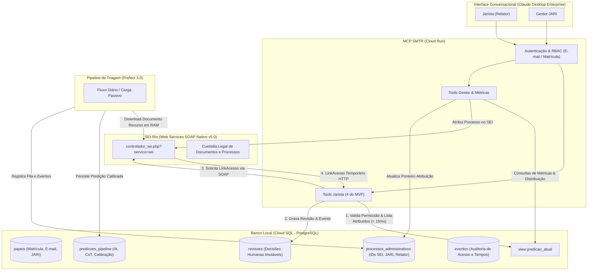
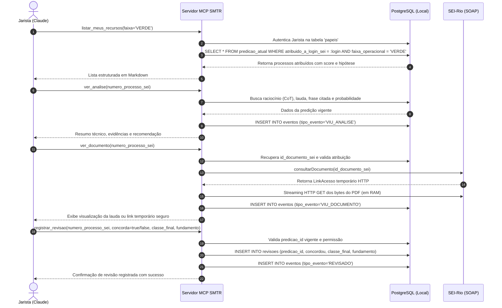

# Integração SEI-Rio via Web Services SOAP Nativo (v5.0)

Este documento especifica a integração técnica entre o **MCP SMTR (Claude Desktop)**, a **Pipeline Prefect** e o **SEI-Rio**, utilizando o **Web Services SOAP Nativo do SEI v5.0** (`controlador_ws.php?servico=sei`), em substituição temporária ao módulo REST `mod-wssei` (suspenso por contingência de segurança PHP até novembro/2026).

---

## 1. Visão Geral e Contexto de Contingência

Devido a vulnerabilidades identificadas na camada PHP do SEI-Rio durante a fase de testes, o módulo complementar `mod-wssei` foi temporariamente bloqueado para auditoria de segurança. Durante este período de contingência, todas as interações com o SEI-Rio devem ocorrer obrigatoriamente através do **Web Services SOAP Nativo (v5.0)** oficial da plataforma.



---

## 2. Paradigma de Autenticação e Segurança

### 2.1. Conta de Sistema vs. Usuário Nominal

A diferença técnica mais crítica entre o `mod-wssei` e o **SOAP Nativo v5.0** reside no modelo de identidade:

| Característica | `mod-wssei` (REST Suspenso) | SOAP Nativo v5.0 (Padrão Oficial) |
| :--- | :--- | :--- |
| **Identidade de Conexão** | Login/senha individual do Jarista ou OAuth | **Conta de Sistema Compartilhada** (`SiglaSistema`) |
| **Chave de Acesso** | Token Bearer JWT por sessão | `IdentificacaoServico` estática (Menu Administração/Sistemas) |
| **Contexto de Unidade** | Header HTTP `unidade` | Parâmetro obrigatório `IdUnidade` no corpo SOAP |
| **Conhecimento do Usuário no SEI** | SEI sabe quem está operando | **SEI NÃO sabe quem é o usuário conversando no Claude** |

> [!CAUTION]
> **Risco de Segurança:** Como a API SOAP utiliza credenciais de sistema compartilhadas, o SEI-Rio não aplica restrições de visibilidade por Jarista nas requisições. 
> 
> **Mitigação Mandatória:** O **Banco Local (Cloud SQL)** DEVE atuar como a barreira estrita de autorização (RBAC). O MCP valida o usuário logado via e-mail corporativo/matrícula do Claude Desktop contra a tabela local `papeis`. Todas as consultas de processos e documentos são filtradas obrigatoriamente por `WHERE atribuido_a_login_sei = :usuario_sei AND codigo_jari = :jari`.

---

## 3. Catálogo de Operações SOAP SEI v5.0 Suportadas

Todas as operações SOAP são disparadas contra o endpoint `http://[servidor_sei]/sei/controlador_ws.php?servico=sei`.

### 3.1. Consulta e Download de Documentos (`consultarDocumento`)

Utilizada para obter metadados e o link direto de download em streaming do recurso protocolado pelo cidadão.

* **Parâmetros de Entrada:**
  * `SiglaSistema` (*string*): Identificador do sistema cadastrado no SEI (ex.: `'SMTR_TRIAGEM'`).
  * `IdentificacaoServico` (*string*): Chave de acesso criptográfica do serviço.
  * `IdUnidade` (*int/string*): Identificador numérico da unidade JARI no SEI.
  * `ProtocoloDocumento` (*string*): Número formatado do documento (ex.: `'0003934'`) ou `IdDocumento` interno.
  * `SinRetornarAndamentoGeracao` (*string*): `'N'`.
  * `SinRetornarAssinaturas` (*string*): `'S'` (para verificar se já foi assinado).
  * `SinRetornarPublicacao` (*string*): `'N'`.
  * `SinRetornarCampos` (*string*): `'N'`.
  * `SinRetornarBlocos` (*string*): `'N'`.

* **Estrutura de Retorno (`RetornoConsultaDocumento`):**
  * `IdDocumento` (*string*): ID numérico interno do documento no SEI.
  * `IdProcedimento` (*string*): ID numérico interno do processo associado.
  * `ProcedimentoFormatado` (*string*): Número visível do processo SEI.
  * `LinkAcesso` (*string*): **URL temporária de acesso direto via HTTP**.
  * `NivelAcessoLocal` (*int*): 0 (Público), 1 (Restrito), 2 (Sigiloso).

* **Fluxo de Download em Memória RAM (Streaming sem Disco):**
  1. A aplicação chama `consultarDocumento` e extrai o `LinkAcesso`.
  2. Dispara um `GET` HTTP na URL fornecida utilizando a sessão da conta de serviço.
  3. Verifica o cabeçalho `Content-Type`:
     * Se `application/pdf` (anexo externo do cidadão): Consome os bytes diretamente em memória RAM.
     * Se `text/html` (despacho interno gerado pelo SEI): Converte em PDF em memória via PyMuPDF.
  4. Extrai a janela de 20 páginas, roda a inferência da IA e **descarta imediatamente o buffer da memória RAM**.

### 3.2. Consulta de Processos e Atribuição Atual (`consultarProcedimento`)

Utilizada para inspecionar andamentos, unidades abertas e o relator responsável no SEI.

* **Parâmetros de Entrada:**
  * `SiglaSistema`, `IdentificacaoServico`, `IdUnidade`.
  * `ProtocoloProcedimento` (*string*): Número visível do processo (ex.: `'12.1.000000077-4'`).
  * `SinRetornarUnidadesProcedimentoAberto` (*string*): `'S'`.
  * `SinRetornarUltimoAndamento` (*string*): `'S'`.

* **Estrutura de Retorno (`RetornoConsultaProcedimento`):**
  * `IdProcedimento` (*string*): ID interno do processo.
  * `ProcedimentoFormatado` (*string*): Número formatado.
  * `LinkAcesso` (*string*): Link web direto para abrir o processo na UI do SEI.
  * `UnidadesProcedimentoAberto`: Array contendo:
    * `Unidade`: Dados da unidade JARI onde o processo tramita.
    * `UsuarioAtribuicao`: Estrutura com `IdUsuario`, `Sigla` e `Nome` do servidor responsável (Jarista relator).

### 3.3. Atribuição de Processos (`atribuirProcesso`)

Utilizada pelo perfil Gestor para delegar a responsabilidade de um recurso a um Jarista específico.

* **Parâmetros de Entrada:**
  * `SiglaSistema`, `IdentificacaoServico`, `IdUnidade`.
  * `ProtocoloProcedimento` (*string*): Número do processo.
  * `IdUsuario` (*string*): Identificador numérico do usuário relator no SIP.
  * `SinReabrir` (*string*): `'N'`.
* **Saída:** Booleano `true` indicando sucesso.
* **Ação Correlata no Banco Local:** Ao confirmar sucesso na chamada SOAP, o MCP atualiza imediatamente o campo `atribuido_a_login_sei` e `status_distribuicao = 'DISTRIBUIDO'` na tabela `processos_administrativos`.

### 3.4. Gestão de Blocos de Assinatura (`gerarBloco`, `incluirDocumentoBloco`, `disponibilizarBloco`)

Utilizada na fase posterior ao MVP (ou homologação de lote) para agrupar pareceres gerados:

* `gerarBloco(SiglaSistema, IdentificacaoServico, IdUnidade, Tipo='A', Descricao, UnidadesDisponibilizacao, Documentos)` -> Retorna `IdBloco`.
* `incluirDocumentoBloco(SiglaSistema, IdentificacaoServico, IdUnidade, IdBloco, ProtocoloDocumento)` -> Retorna `true`.
* `disponibilizarBloco(SiglaSistema, IdentificacaoServico, IdUnidade, IdBloco)` -> Retorna `true`.

### 3.5. Listagem de Usuários da Unidade (`listarUsuarios`)

* **Parâmetros de Entrada:** `SiglaSistema`, `IdentificacaoServico`, `IdUnidade`.
* **Saída:** Lista de usuários cadastrados com perfil ativo na unidade da JARI (`IdUsuario`, `Sigla`, `Nome`).
* **Utilidade:** Utilizado pela sincronização da tabela `papeis` para manter compatibilidade com os logins SIP.

---

## 4. Matriz de Lacunas Funcionais: SOAP v5.0 vs. `mod-wssei`

A tabela abaixo sintetiza as funções ausentes no SOAP nativo e a respectiva solução arquitetural adotada no Banco Local:

| Funcionalidade Desejada | Disponível no `mod-wssei` (REST)? | Disponível no SOAP Nativo v5.0? | Solução Adotada na Arquitetura (Contingência) |
| :--- | :--- | :--- | :--- |
| **Listar processos por Jarista** | Sim (`GET /processo/listar?usuario=X`) | **NÃO** | **Banco Local:** O MCP faz query `SELECT * FROM predicao_atual WHERE atribuido_a_login_sei = :usuario`. Latência < 15ms. |
| **Listar processos da unidade paginado** | Sim (`GET /processo/listar`) | **NÃO** (só consulta individual ou andamentos) | **Pipeline Prefect:** Sincronização diária de caixa via andamentos/SIP, persistindo a fila em `processos_administrativos`. |
| **Assinatura Eletrônica no Chat** | Sim (via módulo customizado) | **NÃO** (exige certificado digital na sessão web) | **Redirecionamento:** O MCP gera o bloco no SEI e devolve o `LinkAcesso` para o Jarista assinar formalmente na web do SEI. |
| **Marcadores Visuais Coloridos** | Sim (gerenciamento dinâmico de tags) | **LIMITADO** (`definirMarcador` exige ID prévio) | **Banco Local:** As faixas operacionais (Verde, Amarela, Vermelha) e hipóteses são exibidas diretamente no Claude Desktop. |
| **Download de PDF Único Consolidado** | Não (já requeria compilação manual) | **NÃO** | **Streaming Cirúrgico:** A pipeline baixa unicamente o `id_documento_sei` (o recurso inicial), eliminando I/O desnecessário de despachos. |

---

## 5. Mapeamento das 11 Tools do MCP SMTR (Contrato Técnico)

### 5.1. Perfil Jarista (Relator)



#### Especificação das Tools do Jarista

| Tool | Finalidade | Interação SEI SOAP | Interação Banco Local | Regra de Domínio / Segurança |
| :--- | :--- | :--- | :--- | :--- |
| `listar_meus_recursos` | Lista recursos atribuídos ao relator logado | Nenhuma | Consulta `predicao_atual` filtrada por `atribuido_a_login_sei` | **Isolamento Estrito:** Jarista jamais visualiza recursos de outro servidor. |
| `ver_analise` | Exibe hipótese sugerida, encaminhamento, CoT e lauda | Nenhuma | Consulta `predicao_atual` e grava evento `VIU_ANALISE` | Se for faixa Vermelha, NIC ou Erro de Imagem: **Oculta recomendação da IA** para forçar análise cega e evitar ancoragem. |
| `ver_documento` | Recupera o PDF do recurso para inspeção visual | `consultarDocumento` -> `LinkAcesso` | Valida vínculo em `processos_administrativos` e grava evento `VIU_DOCUMENTO` | Buffer em RAM temporário; nenhum PDF é gravado em disco ou banco. |
| `registrar_revisao` | Grava o julgamento humano do relator | Nenhuma | Insere em `revisoes` e grava evento `REVISADO` | **Justificativa obrigatória** se discordar da IA ou se a recomendação tiver sido omitida. |
| `homologar_lote` *(Fase 2)* | Agrupa decisões e encaminha para assinatura | `gerarBloco`, `incluirDocumentoBloco`, `disponibilizarBloco` | Lê `revisoes` e grava evento `BLOCO_CRIADO` | Só permite homologar processos previamente revisados. Retorna link do bloco no SEI. |

---

### 5.2. Perfil Gestor (Coordenação da JARI)

| Tool | Finalidade | Interação SEI SOAP | Interação Banco Local | Regra de Domínio / Segurança |
| :--- | :--- | :--- | :--- | :--- |
| `listar_caixa` | Visão geral da caixa da JARI por faixa e status | Nenhuma | Consulta `predicao_atual` agrupada por status e relator | Exclusivo para usuários com papel `GESTOR` em `papeis`. |
| `distribuir` | Atribui lote de processos aos Jaristas | `atribuirProcesso` para cada par [processo, jarista] | Atualiza `atribuido_a_login_sei` e `status_distribuicao = 'DISTRIBUIDO'` | Jarista de destino deve estar ativo na mesma JARI. |
| `redistribuir` | Reatribui processo de um Jarista para outro | `atribuirProcesso` com novo `IdUsuario` | Atualiza `atribuido_a_login_sei` e grava evento `REDISTRIBUIDO` | Registra histórico de reatribuição para auditoria. |
| `consultar_metricas` | Relatórios de acurácia, SLA, concordância e custos | Nenhuma | Agregações SQL sobre `predicoes_pipeline`, `revisoes` e `eventos` | Permite filtrar por período, JARI e relator. |
| `configurar_limiar` | Ajusta o limiar $\tau$ de confiança para a JARI | Nenhuma | Atualiza parâmetro operacional na tabela de configurações | Ajusta a fronteira da faixa Verde (padrão 0.85). |

---

## 6. Estratégia de Testes e Cenários de Borda

### 6.1. Cenários Críticos de Teste

1. **Tentativa de Acesso Cruzado por Jarista:**
   * *Ação:* Jarista A tenta executar `ver_analise` ou `ver_documento` para um processo distribuído ao Jarista B.
   * *Resultado Esperado:* Bloqueio imediato no MCP com erro `403 Forbidden` (*"Processo não atribuído ao seu usuário"*), registrando evento de tentativa indevida.
2. **Expiração do `LinkAcesso` Temporário:**
   * *Ação:* Solicitação de visualização após o tempo limite da URL do SEI.
   * *Resultado Esperado:* O MCP renova o link chamando `consultarDocumento` novamente via SOAP de forma transparente para o usuário.
3. **Indisponibilidade ou Timeout do SEI SOAP:**
   * *Ação:* Instabilidade momentânea no servidor PHP do SEI durante chamada de `consultarDocumento`.
   * *Resultado Esperado:* Retry automático com backoff exponencial (3 tentativas: 1s, 2s, 4s). Se falhar, retornar mensagem amigável no Claude indicando instabilidade no barramento SEI sem derrubar o MCP.
4. **Resolução de Documento HTML Interno vs PDF Externo:**
   * *Ação:* Processo cujo recurso principal foi emitido em formulário HTML do SEI em vez de anexo digitalizado.
   * *Resultado Esperado:* Reconhecimento pelo cabeçalho HTTP e conversão em memória para PDF, garantindo conformidade com a pipeline de visão computacional.

### 6.2. Arquitetura para Transição Futura (`Feature Flag`)

O cliente de comunicação com o SEI no MCP e na Pipeline é desacoplado através de uma interface abstrata (`SEIClientInterface`):

```python
class SEIClientInterface(ABC):
    @abstractmethod
    def consultar_documento(self, id_documento: str) -> dict: ...
    @abstractmethod
    def baixar_conteudo_documento(self, id_documento: str) -> bytes: ...
    @abstractmethod
    def atribuir_processo(self, protocolo: str, login_usuario: str) -> bool: ...
```

Quando o módulo `mod-wssei` retornar após a resolução das vulnerabilidades PHP, bastará alternar a variável de ambiente:
```bash
SEI_ADAPTER_TYPE="soap"  # Atual durante a contingência
# SEI_ADAPTER_TYPE="rest"  # Retorno futuro ao mod-wssei
```

Nenhum código da interface conversacional do Claude nem do fluxo de inteligência artificial da pipeline precisará ser reescrito.
