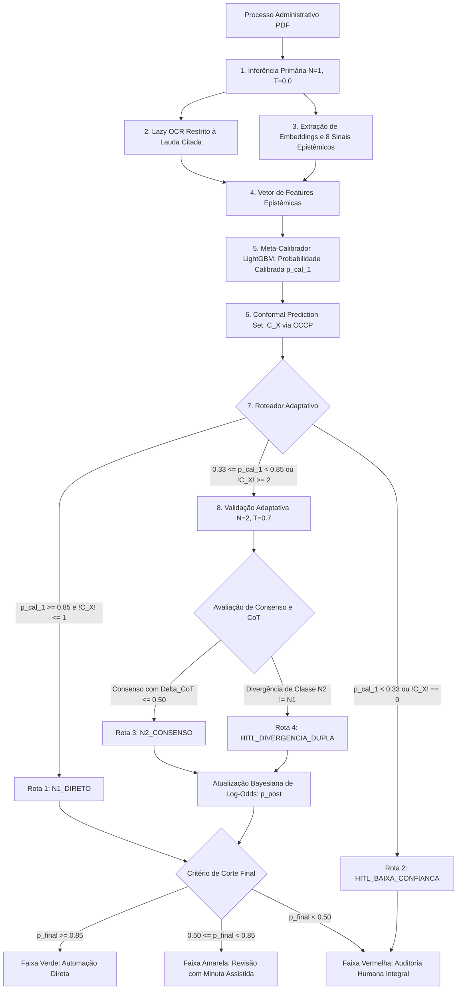

# rj_smtr__triagem_recursos

Pipeline Prefect 3.0 de triagem processual e classificação seletiva para recursos administrativos de multas de trânsito da **Secretaria Municipal de Transportes do Rio de Janeiro (SMTR-RJ)**, integrada ao monorepo da IPLANRIO.

O sistema processa petições em PDF (incluindo peças manuscritas e digitalizações com OCR ruidoso) e enquadra os processos em uma taxonomia de **7 hipóteses legais**, utilizando inferência primária determinística ($N=1$), extração local de **8 sinais epistêmicos ativos**, meta-calibração tabular via LightGBM (ajustada com validação cruzada out-of-fold e calibração isotônica) e predição conformal condicional por classe (CCCP) com roteamento bayesiano adaptativo para auditoria humana (*Human-in-the-Loop* - HITL).

---

## Arquitetura do Pipeline

O pipeline opera por meio de uma cascata adaptativa orientada a risco, desenhada para garantir acurácia $\ge 98.0\%$ no lote automatizado com multiplicador de chamadas $\le 1.10\text{x}$ por processo.

A automação direta nunca é concedida exclusivamente pelo consenso entre chamadas: a decisão final de liberação sem intervenção humana depende estritamente de a probabilidade calibrada final atingir a Faixa Verde ($p_{\text{cal}} \ge 0.85$).



---

## As 8 Features Epistêmicas Ativas

A partir de estudo de ablação empírico sobre o Golden Set de 730 processos, o vetor de features foi reduzido para **8 variáveis essenciais**, eliminando métricas redundantes e mantendo alta capacidade discriminativa (Brier Score = 0.0094):

1. `fuzz_ratio`: Similaridade de Levenshtein entre a frase citada e o texto OCR da lauda.
2. `token_containment`: Proporção de tokens da citação presentes na lauda probatória.
3. `exact_match`: Binária indicando correspondência exata de substrings (1.0 ou 0.0).
4. `adversarial_density`: Frequência de operadores léxicos de oposição e contradição.
5. `sim_centroid_pred`: Similaridade cosseno entre o parecer da LLM e o centróide semântico histórico da classe predita.
6. `mahalanobis_dist`: Distância multivariada corrigida por covariância em relação à classe, capturando atipicidade/OOD.
7. `is_manuscrito`: Estimativa de preenchimento manual via densidade morfológica de contornos.
8. `tesseract_mean_conf`: Nível médio de confiança estatística do motor de OCR na lauda.

---

## Estrutura do Módulo

```text
pipelines/rj_smtr__triagem_recursos/
├── flow.py                         # Orquestrador @flow da pipeline
├── tasks.py                        # Definição fina de @task decoradas
├── constants.py                    # Constantes de negócio, limiares e resolução de ambiente
├── pyproject.toml                  # Manifesto Hatchling do pacote no workspace
├── prefect.yaml                    # Deployments e schedules da SMTR
├── Dockerfile                      # Imagem de execução com dependências de OCR/Tesseract
├── prompts/                        # Prompts de sistema versionados
│   ├── v2-4_fix-confianca.txt
│   └── v3_baseline.txt             # Prompt v3 baseline em produção
├── scripts/                        # Scripts operacionais de banco e suporte
│   ├── setup_local_db.py           # Inicializador de DDL e fila local
│   └── seed_goldenset_to_cloudsql.py # Ingestão do Golden Set no PostgreSQL / Cloud SQL
├── utils/                          # Módulos puros (sem acoplamento com Prefect)
│   ├── artifacts.py                # Manipulação de artefatos
│   ├── calibration.py              # Utilitários de métricas de calibração
│   ├── conformal.py                # Predição conforme condicional por classe (CCCP) e CRC
│   ├── cost_analyzer.py            # Estimativa de custos de chamadas de LLM
│   ├── db.py                       # Helpers de conexão
│   ├── db_repository.py            # Persistência transacional e consulta de fila
│   ├── feature_extractor.py        # Extração dos 8 sinais epistêmicos
│   ├── guardrails.py               # Guardrails de consistência fática
│   ├── meta_calibrator.py          # Carregamento e inferência do LightGBM calibrado
│   ├── ocr_engine.py               # Lazy OCR Tesseract na lauda citada
│   ├── router.py                   # Atualização de log-odds e chaveamento de rotas
│   ├── schemas.py                  # Schemas Pydantic / Enums operacionais
│   ├── storage.py                  # Abstração polimórfica (Local vs GCS)
│   ├── windowing.py                # Smart windowing de PDFs (até 20 páginas em RAM)
│   ├── queries/
│   │   └── create_db.sql           # DDL das 4 tabelas operacionais e triggers
│   └── providers/
│       ├── base.py                 # Interface abstrata de provedor LLM
│       ├── google_client.py        # Conexão nativa Vertex AI
│       └── openai_client.py        # Conexão com Gateway Bifrost / LiteLLM
├── pdfs/                           # (Local / .gitignore) PDFs para testes
├── artifacts/                      # (Local / .gitignore) Artefatos .joblib de calibração
└── docs/                           # (Local / .gitignore) Documentações auxiliares

```

---

## Como Executar a Pipeline

A pipeline foi estruturada para suportar execuções pontuais de teste (como um único processo usando os artefatos já calibrados como baseline) ou lotes de produção, alternando entre ambiente local e nuvem.

### 1. Preparação do Ambiente Local (Docker PostgreSQL)

Inicie o contêiner de banco de dados e configure as tabelas e o caso de teste:

```powershell
# Subir contêiner PostgreSQL 16
docker run --name smtr-postgres-local -e POSTGRES_USER=postgres -e POSTGRES_PASSWORD=postgres -e POSTGRES_DB=smtr_triagem -p 5432:5432 -d postgres:16

# Inicializar esquema DDL e enfileirar registro de teste
uv run pipelines/rj_smtr__triagem_recursos/scripts/setup_local_db.py

```

---

### 2. Execução da Pipeline

A pipeline pode rodar localmente consumindo os arquivos `.joblib` congelados como referência para calibrar novos casos sem a necessidade de reprocessar o Golden Set inteiro.

#### Execução de Teste Unitário / Pontual (1 Processo):

Executa a triagem pontual do processo pendente na fila utilizando os artefatos de referência congelados:

```powershell
uv run --env-file .env python -c "from pipelines.rj_smtr__triagem_recursos.flow import rj_smtr__triagem_recursos; rj_smtr__triagem_recursos(is_local=True, limite_lote=1)"

```

#### Execução em Lote com Prefect CLI:

```powershell
uv run prefect flow-run execute-flow --name rj_smtr__triagem_recursos --param is_local=true --param limite_lote=50

```

#### Execução apontando para Nuvem (Google Cloud SQL e GCS):

```powershell
uv run python -c "from pipelines.rj_smtr__triagem_recursos.flow import rj_smtr__triagem_recursos; rj_smtr__triagem_recursos(is_local=False, modo_execucao='INCREMENTAL', limite_lote=300)"

```

---

### 3. Auditoria do Banco Local

Para inspecionar as predições, o chaveamento de rotas e as features gravadas:

```powershell
docker exec -it smtr-postgres-local psql -U postgres -d smtr_triagem -c "
SELECT 
    p.numero_processo_sei,
    pr.n1_classe_predita,
    pr.probabilidade_final,
    pr.faixa_operacional,
    pr.rota_execucao,
    pr.feat_fuzz_ratio,
    pr.feat_sim_centroid_pred,
    pr.feat_mahalanobis_dist,
    f.status AS status_fila
FROM predicoes_pipeline pr
JOIN processos_administrativos p ON p.processo_id = pr.processo_id
JOIN fila_trabalho f ON f.processo_id = pr.processo_id;
"

```

---

## Resultados Operacionais Consolidados

Métricas obtidas sobre o Golden Set de **730 processos auditados da SMTR-RJ**:

### Distribuição das Rotas Adaptativas e Critérios de Ativação

| Rota de Execução | Volume (%) | Casos (N) | Critério de Ativação | Acurácia Bruta no Grupo | Destino Operacional |
| --- | --- | --- | --- | --- | --- |
| **`N1_DIRETO`** | $85.1\%$ | 621 | $p_1 \ge 0.85$ e !C_X! $\le$ 1 | $98.87\%$ | Faixa Verde: Automação direta |
| **`N2_CONSENSO`** | $7.4\%$ | 54 | $0.33 \le p_1 < 0.85$ + Consenso ($\Delta_{\text{CoT}} \le 0.50$) | $90.74\%$ | Submetido a corte: automatizado se $p_{\text{post}} \ge 0.85$; senão, Faixa Amarela |
| **`HITL_BAIXA_CONFIANCA`** | $6.8\%$ | 50 | $p_1 < 0.33$ ou !C_X! == 0 | $48.00\%$ | Faixa Vermelha: Auditoria integral na mesa humana |
| **`HITL_DIVERGENCIA_DUPLA`** | $0.7\%$ | 5 | Divergência fática entre chamadas ($N_2 \neq N_1$) ou dispersão excessiva | $60.00\%$ | Faixa Vermelha: Dossiê com pareceres em confronto |

---

### Desempenho Comparativo no Ponto de Corte Operacional ($p_{\text{cal}} \ge 0.85$)

| Métrica Avaliada | v2.4 (Bayesiano) | v3 (Bayesiano) | Impacto Operacional |
| --- | --- | --- | --- |
| **Processos Automatizados (Faixa Verde)** | 648 casos | **654 casos** | +6 processos liberados diretamente no v3 |
| **Cobertura de Automação (%)** | $87.33\%$ | **$88.14\%$** | Aumento de eficiência sem perda de controle |
| **Acurácia no Lote Aceito (%)** | $98.77\%$ | **$98.93\%$** | Ambos atendem à meta ($\ge 98.0\%$) |
| **Erros Falsos Positivos Vazados** | 8 erros | **7 erros** | Redução de falso positivo no lote aceito |
| **Carga de Trabalho Humana (HITL Total)** | 94 casos | **88 casos** | Redução de volume encaminhado para revisão |
| **Erros Reais Retidos pelo HITL** | 17 falhas | **32 falhas** | Maior retenção de falhas documentais na triagem |
| **Multiplicador de Chamadas LLM** | **1.06x** | 1.08x | Ambos bem abaixo do teto orçamentário previsto |
| **Mediana de Confiança nos Erros** | 0.1677 | **0.0667** | O v3 concentra 50% dos seus erros abaixo de 6.7% de confiança |
| **ECE (*Expected Calibration Error*)** | **0.0307** | 0.0465 | Ambos mantêm calibração dentro do correto ($< 0.05$) |